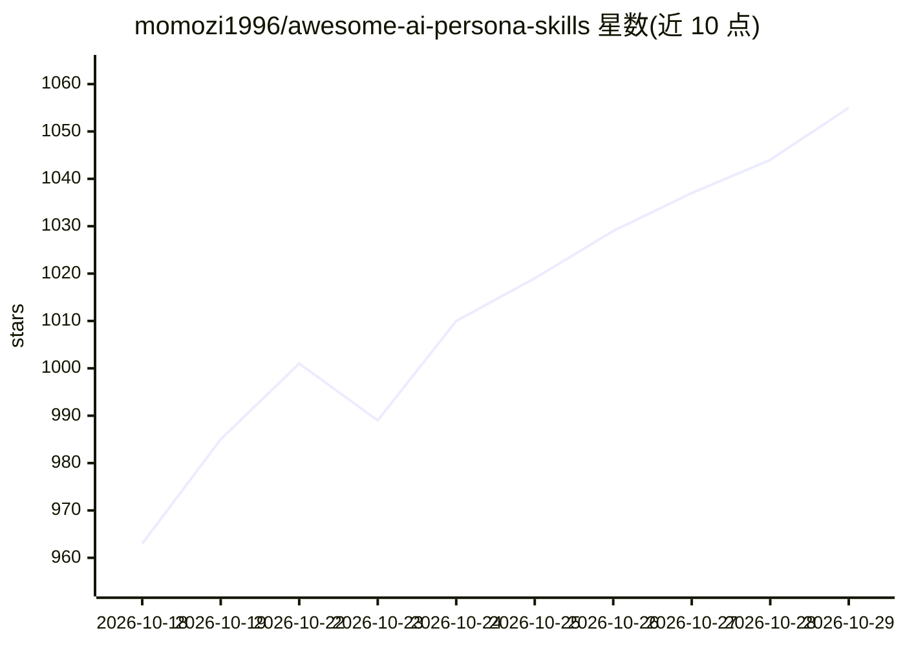

# momozi1996/awesome-ai-persona-skills

⭐ 1,055 · Shell · MIT · 推送 2026-09-02 · [GitHub](https://github.com/momozi1996/awesome-ai-persona-skills) · 个人维护 · 中文 README

**100+ AI 人格蒸馏 Skills 合集：名人/作家/古籍等多品类 agent skill**

由个人维护的 AI 人格 Skill 聚合仓库：收集整理全网 100+ 人格蒸馏 skill，覆盖名人思维、职场、情感陪伴、二次元、玄学等品类，均为统一 Skill 规范格式、可直接导入，兼容 StepClaw / OpenClaw 平台。另含作者自研内容：永乐大典 skill、作家文风 skill、自媒体大V skill、基于 ClawTeam 多 Agent 架构的天涯20大神智囊团、整合31位导演风格的 DirectorAgents 多智能体系统、EQ 情商与社会化训练 skill。README 附多个作家人格生成效果示例，并提供前端试用链接。MIT 许可。

## 筛选速览

| 维度 | 判定 | 备注 |
|---|---|---|
| AI 角色 | `ai-knowledge` | 知识聚合/清单类 |
| 许可风险 | `permissive` | MIT |
| 部署形态 | `None` |  |
| 模型依赖 | — | README 未给出锁定关系 |
| 硬件要求 | — | 无带数字的原话,不猜 |
| 安装摩擦 | `low` | 无编译、无系统依赖或容器化 |
| 成熟度 | — | 结构信号不足 |

## 能力要点

- 100+ 人格 skill 收录，统一 Skill 规范格式，兼容 StepClaw / OpenClaw
- 自研多 Agent 内容：天涯20大神智囊团（ClawTeam 架构）、31位导演 DirectorAgents（三种协作模式）
- 自研蒸馏内容：永乐大典、作家文风、自媒体大V、EQ 情商训练 skill
- README 提供前端在线试用 skill 的链接

## 适用场景

- 为 agent 配置名人/作家/职场等人格 skill
- 搭建多 Agent 协作创作或决策团队
- 复刻特定作家或自媒体大V的创作风格

## 场景标签

`精选清单` `提示工程` · 领域:Agent 开发

## 证据(README 行号)

> L17:  1、 【收集汇总】全网合集 100+ 成熟AI人格Skill
> L61: 全部统一 Skill 规范格式，开箱即用，兼容 StepClaw / OpenClaw 全平台，是目前开源圈内**收录最全、更新最稳定**的轻量化人格 Skill 仓库。

## 星数曲线

2026-10-18 963 → 2026-10-29 1,055（+92）

---
*卡片 v1 · prompt 1.4 · 生成 2026-10-21 · 置信度 high · 依据 README sha `f11fc5cf99b5` · [字段定义](../../DATASET.md)*
