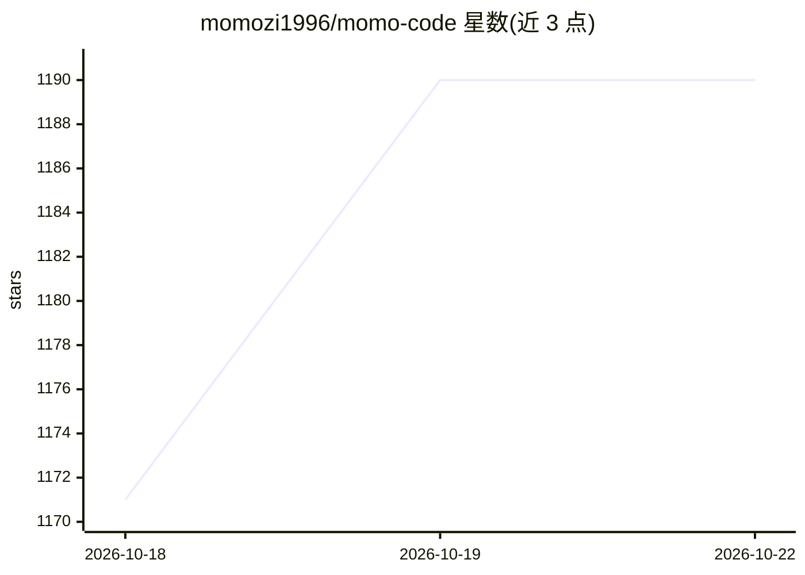

# momozi1996/momo-code

⭐ 1,190 · TypeScript · NOASSERTION · 推送 2026-10-17 · [GitHub](https://github.com/momozi1996/momo-code) · [官网](https://momozi.cc) · 个人维护 · 中文 README

**带自进化机制的终端 AI 编程代理（基于 opencode/Pi 框架）**

构建在 opencode 之上、以 npm 依赖形式集成 Pi 框架（pi-coding-agent@1.1.0，非 fork）的 CLI 编程代理。v2.0 提供交互式 REPL（思维链面板、决策胶囊、快捷键）、JEV 决策层（5 个决策门、影子模式 + ECE 校准）、RSI 三级自进化循环（R1 提示词补丁全自动 / R2 权重自动+校准门 / R3 生成提案需人工 Review，带预算护栏与 STOP 停止文件）、momo-bench 三层评估与 7 个反向测试，另有递归子代理、DAG 图引擎、定时任务 daemon、Genesis 物理仿真代理与语音输入。支持 25+ LLM 提供商（OpenAI 兼容协议），可继承 .claude/ 配置与 MCP。README 自称处于实验性/重大架构升级中；npm 包尚未发布（v1.1 计划），需 curl 脚本或源码安装，macOS/Linux（Windows 需 WSL）+ Node.js ≥20。

## 筛选速览

| 维度 | 判定 | 备注 |
|---|---|---|
| AI 角色 | `ai-native` | 本体是模型或模型工具 |
| 许可风险 | `none` | NOASSERTION |
| 部署形态 | `library` | 以包/库形式分发 |
| 模型依赖 | locked-api |  |
| 硬件要求 | — | 无带数字的原话,不猜 |
| 安装摩擦 | `low` | 无编译、无系统依赖或容器化 |
| 成熟度 | `idea` | |

## 能力要点

- Pi 框架扩展模式集成 + 6 个专属扩展（experience/rsi/permissions/decisions/cot/brand）
- JEV 决策层：5 个决策门，影子模式并行记录并 ECE 校准
- RSI 三级自进化循环，带日限额/成本上限与 STOP 文件急停
- /graph 将长程任务规划为可恢复的子代理 DAG 并行执行

## 适用场景

- 在终端用自然语言驱动 AI 编写与重构代码
- 让代理自动蒸馏历史成功战术注入后续提示词
- 把长程任务拆成 DAG 子代理并行执行并断点续跑
- 用 LLM 控制持久 Genesis 物理世界做仿真实验

## 场景标签

`编码 Agent` · 领域:编码与开发

## 证据(README 行号)

> L22: > **AI-powered coding agent that evolves with you.**
> L103: - **25+ LLM Providers** — Deepseek, Zhipu (GLM), Moonshot (Kimi), Claude, GPT-4, Gemini, Doubao, OpenRouter, Groq,
> L120: - **Local-first** — Your code never leaves your machine. Open source, auditable

## 星数曲线

2026-10-18 1,171 → 2026-10-22 1,190（+19）

---
*卡片 v1 · prompt 1.4 · 生成 2026-10-21 · 置信度 mid · 依据 README sha `ae61c383f2d4` · [字段定义](../../DATASET.md)*
