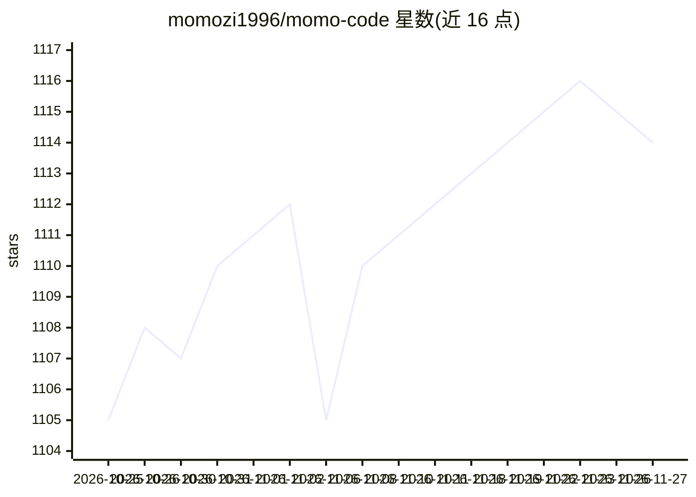

# momozi1996/momo-code

⭐ 1,114 · TypeScript · NOASSERTION · 推送 2026-10-27 · [GitHub](https://github.com/momozi1996/momo-code) · [官网](https://momozi.cc) · 个人维护 · 中文 README

**带自进化机制的个人 AI 编码 Agent CLI**

基于 opencode 构建的 CLI 编码 Agent，核心是 RSI 三级自进化循环（R1 提示词/战术、R2 决策模型权重、R3 评估器提案）与 JEV 五决策门（影子模式 + ECE 校准）。提供交互式 REPL（思维链面板、决策胶囊）、momo-bench 三层评估、递归子代理与 DAG 图引擎、长期目标守护进程、Genesis 物理世界仿真代理及语音输入。支持 25+ LLM 提供商，本地优先。当前版本处于实验性活跃开发状态。

## 筛选速览

| 维度 | 判定 | 备注 |
|---|---|---|
| AI 角色 | `ai-native` | 本体是模型或模型工具 |
| 许可风险 | `none` | NOASSERTION |
| 部署形态 | `library` | 以包/库形式分发 |
| 模型依赖 | — | README 未给出锁定关系 |
| 硬件要求 | — | 无带数字的原话,不猜 |
| 安装摩擦 | `low` | 无编译、无系统依赖或容器化 |
| 成熟度 | `idea` | |

## 能力要点

- RSI 三级自进化循环，带预算护栏与 STOP 停止开关
- JEV 决策层：5 决策门，影子模式 + ECE 校准
- momo-bench 三层评估 + 7 个反向测试防作弊
- DAG 图引擎与递归子代理，状态持久可断点续跑

## 适用场景

- 在终端用自然语言完成编码任务并让 Agent 沉淀战术经验
- 对复杂长任务做子代理分解与依赖图并行执行
- 用评估门控自动/半自动改进 Agent 自身提示词与决策权重
- 通过守护进程持续执行定时任务与长期目标

## 场景标签

`编码 Agent` · 领域:编码与开发

## 证据(README 行号)

> L22: > **AI-powered coding agent that evolves with you.**
> L103: - **25+ LLM Providers** — Deepseek, Zhipu (GLM), Moonshot (Kimi), Claude, GPT-4, Gemini, Doubao, OpenRouter, Groq,
> L143: curl -fsSL https://momozi.cc/install | bash

## 星数曲线

2026-10-25 1,105 → 2026-11-27 1,114（+9）

---
*卡片 v1 · prompt 1.4 · 生成 2026-11-25 · 置信度 mid · 依据 README sha `bdcdc942a0fc` · [字段定义](../../DATASET.md)*
