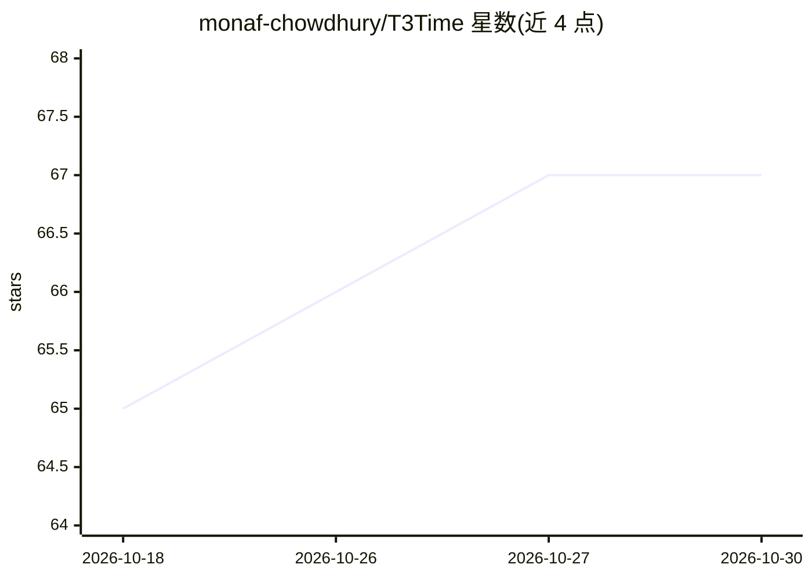

# monaf-chowdhury/T3Time

⭐ 67 · Python · MIT · 推送 2025-12-06 · [GitHub](https://github.com/monaf-chowdhury/T3Time) · [官网](https://arxiv.org/abs/2508.04251) · 组织维护

**AAAI'26 论文实现：三模态多变量时间序列预测框架**

T3Time 论文（AAAI'26 Poster, arXiv:2508.04251）的官方代码实现：面向多变量时间序列预测（MTSF），框架由时间、频谱、prompt 三分支组成，包含频域编码分支、按预测视野门控时间/频谱特征、多头跨模态对齐的自适应加权聚合与残差融合。依赖 Python 3.11、PyTorch 2.1.2 与 CUDA 12.1，通过 conda 环境文件与 shell 脚本完成嵌入存储、训练与推理，数据集取自 TimesNet 与 TFB。以研究代码形式提供，面向科研复现与实验。

## 筛选速览

| 维度 | 判定 | 备注 |
|---|---|---|
| AI 角色 | `ai-native` | 本体是模型或模型工具 |
| 许可风险 | `permissive` | MIT |
| 部署形态 | `library` | 以包/库形式分发 |
| 模型依赖 | — | README 未给出锁定关系 |
| 硬件要求 | — | 无带数字的原话,不猜 |
| 安装摩擦 | `medium` | 含编译或系统依赖之一 |
| 成熟度 | — | 结构信号不足 |

## 能力要点

- 时间/频谱/prompt 三分支结构，按预测视野门控
- 跨模态对齐多头自适应加权聚合与残差融合
- 提供嵌入存储、训练与推理 shell 脚本
- 论文报告在基准数据集上 MSE 平均降低 3.37%

## 适用场景

- 复现论文的时间序列预测实验结果
- 在 TimesNet/TFB 数据集上训练与对比预测模型
- 研究多模态特征融合方法在预测中的应用

## 场景标签

`科研工具` · 领域:学习与行业

## 证据(README 行号)

> L1: (AAAI'26) (Poster) T3Time: Tri-Modal Time Series Forecasting via Adaptive Multi-Head Alignment and Residual Fusion
> L15: Multivariate time series forecasting (MTSF) seeks to model temporal dynamics among variables to predict future tren

## 星数曲线

2026-10-18 65 → 2026-10-30 67（+2）

---
*卡片 v1 · prompt 1.4 · 生成 2026-10-24 · 置信度 mid · 依据 README sha `a724c2276db8` · [字段定义](../../DATASET.md)*
