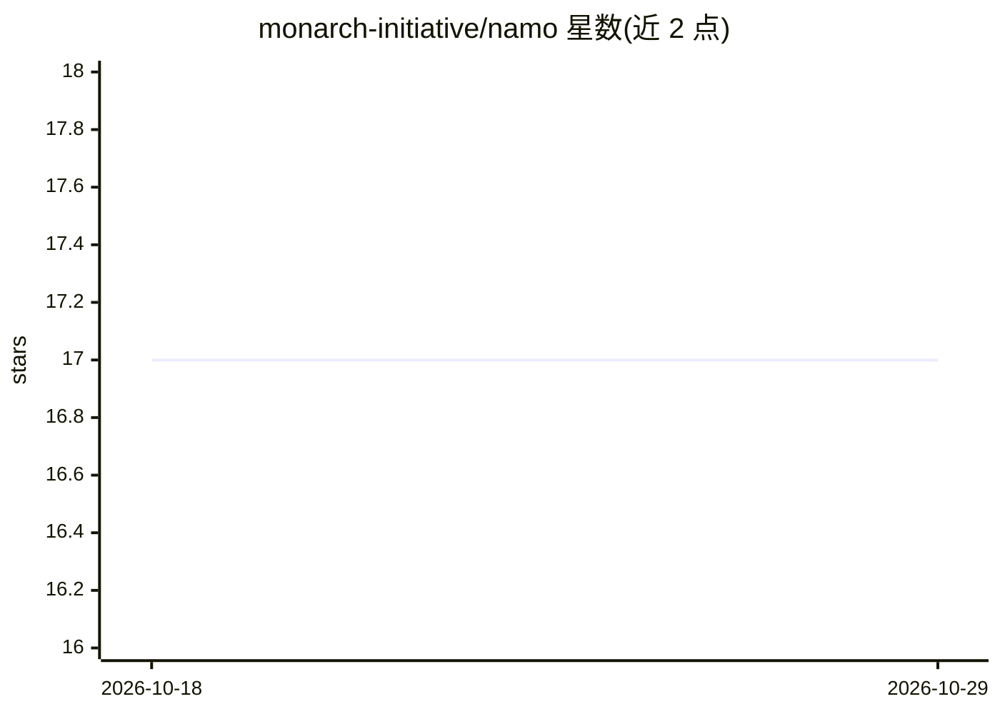

# monarch-initiative/namo

⭐ 17 · Python · BSD-3-Clause · 推送 2026-10-28 · [GitHub](https://github.com/monarch-initiative/namo) · [官网](https://monarch-initiative.github.io/namo/) · 组织维护

**新方法学（NAM）本体与 Schema：生命科学语义数据模型**

Monarch Initiative 维护的 New Approach Methodology Ontology and Schema 项目，基于 LinkML 定义语义数据模型并含本体式元素，导出为本体（BioPortal）以便浏览与本体 API 调用。仓库含 mkdocs 文档、生成的 schema 文档与 Python datamodel、示例数据与测试；开发命令以 just 命令运行器组织。项目基于 linkml-project-copier 模板生成。README 未展示面向最终用户的功能性 AI 能力。

## 筛选速览

| 维度 | 判定 | 备注 |
|---|---|---|
| AI 角色 | `ai-knowledge` | 知识聚合/清单类 |
| 许可风险 | `permissive` | BSD-3-Clause |
| 部署形态 | `None` |  |
| 模型依赖 | — | README 未给出锁定关系 |
| 硬件要求 | — | 无带数字的原话,不猜 |
| 安装摩擦 | `low` | 无编译、无系统依赖或容器化 |
| 成熟度 | — | 结构信号不足 |

## 能力要点

- LinkML schema 定义语义数据模型，含本体式元素
- 导出为本体供 BioPortal 浏览与本体 API 调用
- 生成 Python datamodel、文档与测试
- just 命令运行器提供预定义开发命令

## 适用场景

- 为新方法学（如类器官研究）数据提供标准化语义模型
- 通过本体 API 浏览和调用 NAMO 概念
- 在 LinkML 生态中扩展生命科学数据 schema

## 场景标签

 · 领域:生物医学本体/数据标准

## 证据(README 行号)

> L5: New Approach Methodology Ontology and Schema
> L13: NAMO is a semantic data model with ontology-like elements. We export it as an ontology to facilitate browsing and o

## 星数曲线

2026-10-18 17 → 2026-10-29 17（+0）

---
*卡片 v1 · prompt 1.4 · 生成 2026-10-29 · 置信度 mid · 依据 README sha `4e30eeec2377` · [字段定义](../../DATASET.md)*
