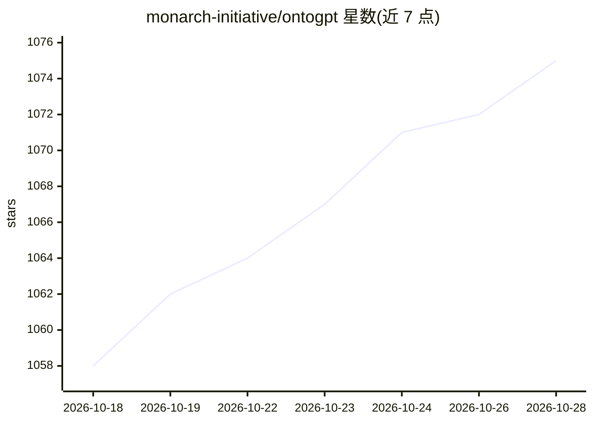

# monarch-initiative/ontogpt

⭐ 1,079 · Jupyter Notebook · BSD-3-Clause · 推送 2026-09-10 · [GitHub](https://github.com/monarch-initiative/ontogpt) · [官网](https://monarch-initiative.github.io/ontogpt/) · 组织维护

**用 LLM 与本体从文本抽取结构化信息的 Python 工具（SPIRES）**

Monarch Initiative 维护的 Python 包：基于 LinkML schema 的 SPIRES 方法，用 LLM 逐类递归抽取文本中的结构化数据，名称经 OAK 注释器在本体中落地并验证标识符，无法落地时以 AUTO: 前缀标记；附带数十个覆盖疾病、表型、基因等的现成模板，输出 YAML/JSON/RDF/OWL。面向生物医学知识库构建者与信息抽取开发者。通过 LiteLLM 接入 OpenAI、Anthropic、Groq 等多家模型 API，也支持 ollama 运行本地模型；提供 CLI、最小 Web 应用与四个 Agent Skills。SPIRES 方法发表于 Bioinformatics 2024。

## 筛选速览

| 维度 | 判定 | 备注 |
|---|---|---|
| AI 角色 | `ai-native` | 本体是模型或模型工具 |
| 许可风险 | `permissive` | BSD-3-Clause |
| 部署形态 | `library` | 以包/库形式分发 |
| 模型依赖 | local-ok | 支持本地模型 |
| 硬件要求 | — | 无带数字的原话,不猜 |
| 安装摩擦 | `low` | 无编译、无系统依赖或容器化 |
| 成熟度 | — | 结构信号不足 |

## 能力要点

- SPIRES 递归遍历 LinkML schema，逐类小提示词抽取，输出符合完整 schema
- 名称经 OAK 本体落地并验证标识符，未落地名称标 AUTO: 前缀
- 数十个捆绑模板覆盖疾病、表型、药物、基因、GO 条目等领域
- 经 LiteLLM 支持 OpenAI/Anthropic/Mistral/Groq 等多家，ollama 可跑本地模型
- 输出 YAML/JSON/RDF/OWL，含标识符验证报告

## 适用场景

- 从生物医学文献批量抽取疾病、表型、基因等结构化数据
- 构建本体接地的知识库且要求标识符真实存在
- AI agent 调用现成技能完成抽取与落地步骤

## 场景标签

`科研工具` `知识图谱` · 领域:知识与检索

## 证据(README 行号)

> L10: _OntoGPT_ is a Python package for extracting structured information from text with large language models (LLMs), _i
> L18: * **Grounding without hallucination.** Ask an LLM for an ontology identifier and it will often invent one, or attac
> L164: The information extraction approach used in OntoGPT, SPIRES, is described further in: Caufield JH, Hegde H, Emonet

## 星数曲线

2026-10-18 1,058 → 2026-10-28 1,075（+17）

---
*卡片 v1 · prompt 1.4 · 生成 2026-10-21 · 置信度 high · 依据 README sha `d9c69768dfe8` · [字段定义](../../DATASET.md)*
