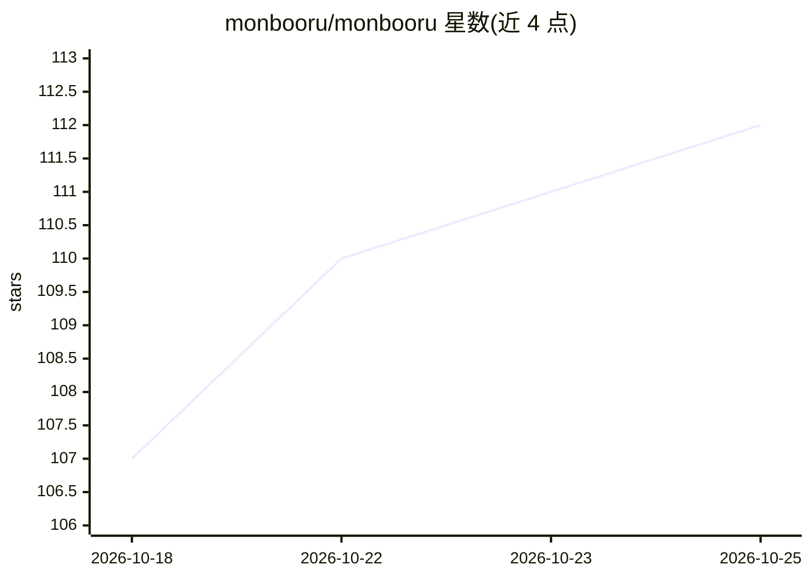

# monbooru/monbooru

⭐ 112 · Go · AGPL-3.0 · 推送 2026-10-23 · [GitHub](https://github.com/monbooru/monbooru) · [官网](https://monbooru.github.io/mondocs/) · 个人维护

**自托管私有图库（booru 式），含本地自动打标**

用 Go 编写的单体二进制自托管 booru 风格图片/视频/CBZ 画廊，面向管理本地媒体收藏（含 AI 生成图）的个人用户。提供标签画廊与搜索、A1111/Forge 与 ComfyUI 元数据读取、SHA-256 去重、近重复检测、收件箱审阅流程、多画廊实例、REST API 与插件主题机制。本地 ONNX 自动打标（WD14、JoyTag 等）在独立 worker 中运行，不含模型；在线功能由可选伴随程序 monloader 承担，应用本身不联网。Docker 或下载二进制运行，SQLite 存储，ffmpeg 为可选依赖。设计定位局域网使用，不面向公网暴露。

## 筛选速览

| 维度 | 判定 | 备注 |
|---|---|---|
| AI 角色 | `ai-enhanced` | 去掉 AI 部分产品仍成立 |
| 许可风险 | `viral` | AGPL-3.0 |
| 部署形态 | `self-host` | docker 或自建部署 |
| 模型依赖 | — | README 未给出锁定关系 |
| 硬件要求 | — | 无带数字的原话,不猜 |
| 安装摩擦 | `low` | 无编译、无系统依赖或容器化 |
| 成熟度 | — | 结构信号不足 |

## 能力要点

- 编译为单二进制（约 21 MB），SQLite 存储，无需外部数据库
- 本地 ONNX 自动打标（WD14/JoyTag 等），CPU 或 GPU 运行
- 读取 A1111/Forge 与 ComfyUI 生成元数据（prompts、models、seeds、工作流）
- 文件监听、SHA-256 去重、近重复检测与收件箱审阅流程

## 适用场景

- 整理本地收藏与 AI 生成图片并用标签检索
- 自动为本地图库批量打标
- 管理多套独立画廊并按标签/收藏夹/合集组织图片
- 通过 REST API 与第三方工具集成

## 场景标签

`目标检测` · 领域:感知与多模态

## 证据(README 行号)

> L4: Designed for organizing your local media collection, including AI-generated images (Stable Diffusion, ComfyUI, A1111
> L10: - **Local ONNX auto-tagging** (WD14 SwinV2, animetimm EVA02, JoyTag, Camie v2, PixAI, or any compatible model) on C

## 星数曲线

2026-10-18 107 → 2026-10-25 112（+5）

---
*卡片 v1 · prompt 1.4 · 生成 2026-10-23 · 置信度 high · 依据 README sha `bbbe6ac289d1` · [字段定义](../../DATASET.md)*
