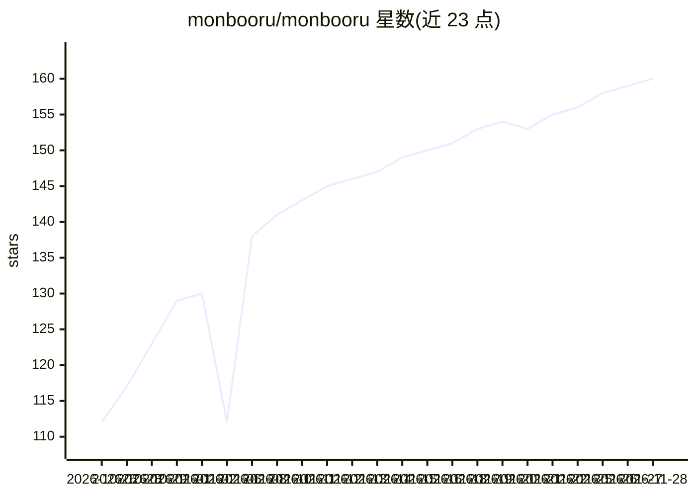

# monbooru/monbooru

⭐ 160 · Go · AGPL-3.0 · 推送 2026-11-27 · [GitHub](https://github.com/monbooru/monbooru) · [官网](https://monbooru.github.io/demo/) · 个人维护

**个人图片库的自托管 booru 式标签画廊**

单二进制 Go 应用，本地部署的 Danbooru 风格标签画廊，管理本地图片、视频、GIF 与漫画压缩包。核心机制：手动打标或用 ONNX 模型（WD14、JoyTag 等）本地自动打标，按标签检索；读取 A1111/Forge 与 ComfyUI 的生成元数据；SHA-256 去重与近似重复检测；文件监视器自动入库。应用本身不联网，在线功能由可选伴生工具 monloader 承担；每个画廊对应一个 SQLite 文件，定位为本地网络使用，不建议暴露公网。

## 筛选速览

| 维度 | 判定 | 备注 |
|---|---|---|
| AI 角色 | `ai-enhanced` | 去掉 AI 部分产品仍成立 |
| 许可风险 | `viral` | AGPL-3.0 |
| 部署形态 | `self-host` | docker 或自建部署 |
| 模型依赖 | local-ok | 支持本地模型 |
| 硬件要求 | — | 无带数字的原话,不猜 |
| 安装摩擦 | `low` | 无编译、无系统依赖或容器化 |
| 成熟度 | — | 结构信号不足 |

## 能力要点

- 本地 ONNX 自动打标（WD14 SwinV2、JoyTag、Camie v2 等，CPU/GPU 可运行）
- 读取 A1111/Forge 与 ComfyUI 生成元数据（提示词、模型、种子、工作流）
- SHA-256 去重与近似重复检测，带并排审阅清理工具
- 单 Go 二进制 + 每画廊一个 SQLite 文件，无数据库服务器

## 适用场景

- 整理本地动漫/漫画图片收藏并按标签检索
- 离线环境给个人图片库自动打标签
- 管理 AI 生图产出的图片并保留生成参数
- 在本地网络自建带密码访问的私人画廊

## 场景标签

`图像视频处理` · 领域:感知与多模态

## 证据(README 行号)

> L3: Your own private, lightweight and fast booru: a tag-based image gallery, in the style of Danbooru, for your files.
> L5: Designed for organizing your local media collection: images, videos, animated GIFs and manga archives. Tag it by han

## 星数曲线

2026-10-26 112 → 2026-11-28 160（+48）

---
*卡片 v1 · prompt 1.4 · 生成 2026-11-27 · 置信度 high · 依据 README sha `b8f085b28883` · [字段定义](../../DATASET.md)*
