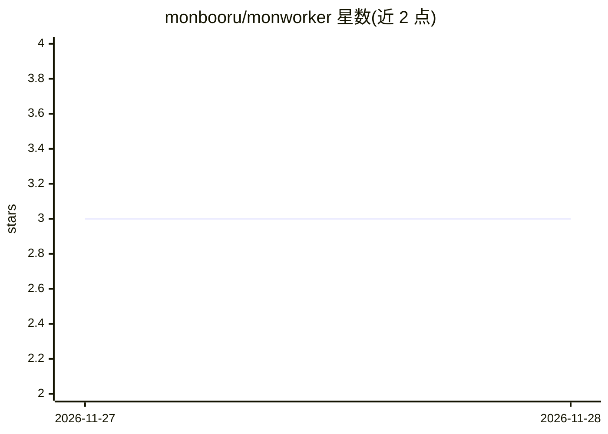

# monbooru/monworker

⭐ 3 · Go · AGPL-3.0 · 推送 2026-11-21 · [GitHub](https://github.com/monbooru/monworker) · 个人维护

**monbooru 的机器学习打标 worker，CPU/GPU 运行 ONNX 自动打标模型**

monbooru 图像集合自托管体系中的机器学习组件，负责运行自动打标（auto-tagging）的 ONNX 模型，输入图像并生成标签输出，支持 CPU、NVIDIA CUDA、Intel GPU（OpenVINO）、DirectML 等执行后端。组件为可选项，monbooru 官方下载与 Docker 镜像（-lite 变体除外）已内置；也可独立部署在另一台机器上打标。通过环境变量配置与 monbooru 配对、模型目录、并发数、空闲后卸载模型释放显存等行为，以 Docker 镜像形式分发，AGPL-3.0 许可。

## 筛选速览

| 维度 | 判定 | 备注 |
|---|---|---|
| AI 角色 | `ai-native` | 本体是模型或模型工具 |
| 许可风险 | `viral` | AGPL-3.0 |
| 部署形态 | `None` |  |
| 模型依赖 | local-ok | 支持本地模型 |
| 硬件要求 | — | 无带数字的原话,不猜 |
| 安装摩擦 | `medium` | 含编译或系统依赖之一 |
| 成熟度 | — | 结构信号不足 |

## 能力要点

- 运行 monbooru 的自动打标 ONNX 模型，输出图像标签
- 支持 cpu/cuda/directml/openvino 多种执行后端镜像
- 空闲后自动卸载模型并释放内存与显存
- 可独立部署在其他机器上为 monbooru 打标

## 适用场景

- 为自托管的 monbooru 图像集合提供自动打标
- 在单独的 GPU 机器上运行打标服务供 monbooru 调用
- 需要 Intel GPU（OpenVINO）后端执行打标模型的部署

## 场景标签

`目标检测` · 领域:感知与多模态

## 证据(README 行号)

> L3: The Machine Learning (ONNX) worker of monbooru: it runs the auto-tagging models, on CPU or GPU.
> L39: |`MONWORKER_PROVIDER`|`cpu`; `cuda` and `openvino` in those images|`cpu`, `cuda`, `directml`, `openvino`, ...|

## 星数曲线

2026-11-27 3 → 2026-11-28 3（+0）

---
*卡片 v1 · prompt 1.4 · 生成 2026-11-27 · 置信度 high · 依据 README sha `b8d2bc06e99e` · [字段定义](../../DATASET.md)*
