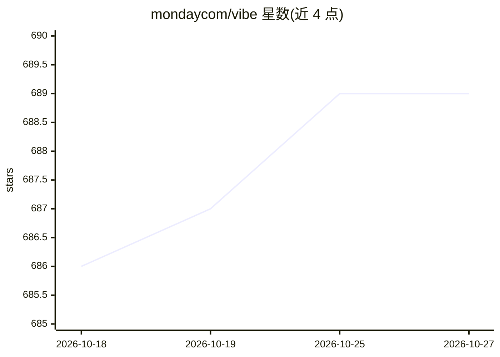

# mondaycom/vibe

⭐ 689 · TypeScript · 推送 2026-10-25 · [GitHub](https://github.com/mondaycom/vibe) · [官网](https://vibe.monday.com/) · 组织维护

**monday.com 官方 React UI 设计系统与组件库**

monday.com 官方维护的 React.js UI 资源集合：提供核心组件库（@vibe/core）、图标库、Playwright 测试工具、codemod CLI、样式基础与 Storybook 组件等包。通过 npm/yarn 安装，从根入口导入组件并引入 tokens CSS。附带 @vibe/mcp MCP 服务器，为 AI 开发工具提供组件 API 发现、用法示例与图标查找辅助。Vibe 3 仅接受关键缺陷修复，Vibe 2 不再维护，当前主推 Vibe 4。

## 筛选速览

| 维度 | 判定 | 备注 |
|---|---|---|
| AI 角色 | `ai-enhanced` | 去掉 AI 部分产品仍成立 |
| 许可风险 | `none` | — |
| 部署形态 | `library` | 以包/库形式分发 |
| 模型依赖 | — | README 未给出锁定关系 |
| 硬件要求 | — | 无带数字的原话,不猜 |
| 安装摩擦 | `low` | 无编译、无系统依赖或容器化 |
| 成熟度 | — | 结构信号不足 |

## 能力要点

- @vibe/core 核心组件库与配套 icons/testkit/codemod 生态包
- @vibe/mcp MCP 服务器辅助 AI 工具使用组件
- 提供文档、组件目录与 Playground

## 适用场景

- 用 React 构建符合 monday.com 风格的应用界面
- 在 AI 编码工具中通过 MCP 获取组件用法与图标建议
- 借助 codemod 在版本间迁移

## 场景标签

 · 领域:前端/设计系统

## 证据(README 行号)

> L4: Official monday.com UI resources for application development in React.js
> L17: Vibe Design System is a collection of packages designed to streamline your development process and enhance the user
> L41: ### MCP

## 星数曲线

2026-10-18 686 → 2026-10-27 689（+3）

---
*卡片 v1 · prompt 1.4 · 生成 2026-10-22 · 置信度 mid · 依据 README sha `d9f98274f86e` · [字段定义](../../DATASET.md)*
