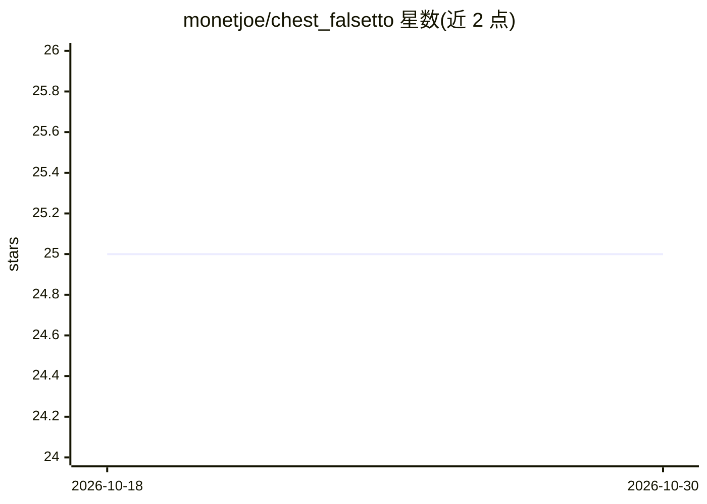

# monetjoe/chest_falsetto

⭐ 25 · Python · MIT · 推送 2026-07-11 · [GitHub](https://github.com/monetjoe/chest_falsetto) · [官网](https://ccmusic-database-chest-falsetto.ms.show) · 个人维护 · 中文 README

**上传歌唱录音，判别男/女真声与假声四类唱法**

基于深度学习的真假声唱法分类 WebUI（Gradio 应用）：用户上传歌唱录音并提交后，系统用 CNN 从录音中提取特征并完成分类，区分男真声、男假声、女真声、女假声四个类别。面向歌手、音乐爱好者及音乐产业专业人士，部署于 Hugging Face Spaces，无需本地安装即可使用。README 未提供本地安装命令或模型细节。

## 筛选速览

| 维度 | 判定 | 备注 |
|---|---|---|
| AI 角色 | `ai-native` | 本体是模型或模型工具 |
| 许可风险 | `permissive` | MIT |
| 部署形态 | `None` |  |
| 模型依赖 | — | README 未给出锁定关系 |
| 硬件要求 | — | 无带数字的原话,不猜 |
| 安装摩擦 | `low` | 无编译、无系统依赖或容器化 |
| 成熟度 | — | 结构信号不足 |

## 能力要点

- 四类唱法分类：男真声/男假声/女真声/女假声
- 深度学习从歌唱录音提取声学特征
- Gradio WebUI，上传录音即可获得分类结果

## 适用场景

- 歌手或音乐教师检验自己的真假声使用情况
- 音乐爱好者对自己录音做唱法分类
- 音乐产业中对歌唱录音做声学特征分析辅助

## 场景标签

 · 领域:音频/音乐信息检索

## 证据(README 行号)

> L1: # 真假声唱法判别器 WebUI
> L7: 真假声唱法判别器是一款专为准确识别不同声音特征而设计的多功能工具。该应用具备对男真声、男假声、女真声和女假声等四个具体类别进行区分的能力。用户只需上传歌唱录音并点击提交，系统将在一定时间内完成对该歌唱录音的真假声唱法分类。该判别器的

## 星数曲线

2026-10-18 25 → 2026-10-30 25（+0）

---
*卡片 v1 · prompt 1.4 · 生成 2026-10-27 · 置信度 high · 依据 README sha `d05bdb66853b` · [字段定义](../../DATASET.md)*
