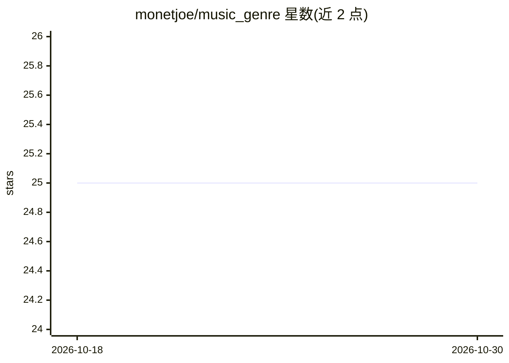

# monetjoe/music_genre

⭐ — · [GitHub]() · 个人维护 · 中文 README

**上传 MP3 识别 16 种音乐流派的 Web 应用**

基于 Gradio 的音乐流派识别 WebUI：用户上传 MP3 音频文件，从 16 种可用模型中选择其一，点击提交后应用输出音频所属的音乐流派。可识别的流派覆盖流行、摇滚、爵士、古典等 16 类音乐风格。面向音乐爱好者与行业人士提供浏览器内操作界面，托管于 Hugging Face Space。README 未给出本地安装运行的命令与依赖说明。

## 筛选速览

| 维度 | 判定 | 备注 |
|---|---|---|
| AI 角色 | `ai-native` | 本体是模型或模型工具 |
| 许可风险 | `permissive` | — |
| 部署形态 | `None` |  |
| 模型依赖 | — | README 未给出锁定关系 |
| 硬件要求 | — | 无带数字的原话,不猜 |
| 安装摩擦 | `low` | 无编译、无系统依赖或容器化 |
| 成熟度 | — | 结构信号不足 |

## 能力要点

- 支持上传 MP3 音频并输出流派识别结果
- 提供 16 种模型供用户按音频内容选择
- 可识别 16 种音乐流派（流行、摇滚、爵士、古典等）

## 适用场景

- 我想知道一段 MP3 音频属于哪种音乐流派
- 对比不同模型在同一音频上的流派识别结果

## 场景标签

 · 领域:音频/音乐流派分类

## 证据(README 行号)

> L1: # 音乐流派识别器 WebUI
> L7: 音乐流派识别器是一种多功能工具，旨在识别多样化的音乐流派。具备识别16种独特音乐流派的能力，该应用允许用户上传MP3音频文件，选择适当的模型，点击提交即可立即识别音频中的音乐流派。用户可以轻松浏览16种可用的音乐流派，涵盖从流行和摇

## 星数曲线

2026-10-18 25 → 2026-10-30 25（+0）

---
*卡片 v1 · prompt 1.4 · 生成 2026-10-27 · 置信度 low · 依据 README sha `7ff8e44c7e12` · [字段定义](../../DATASET.md)*
