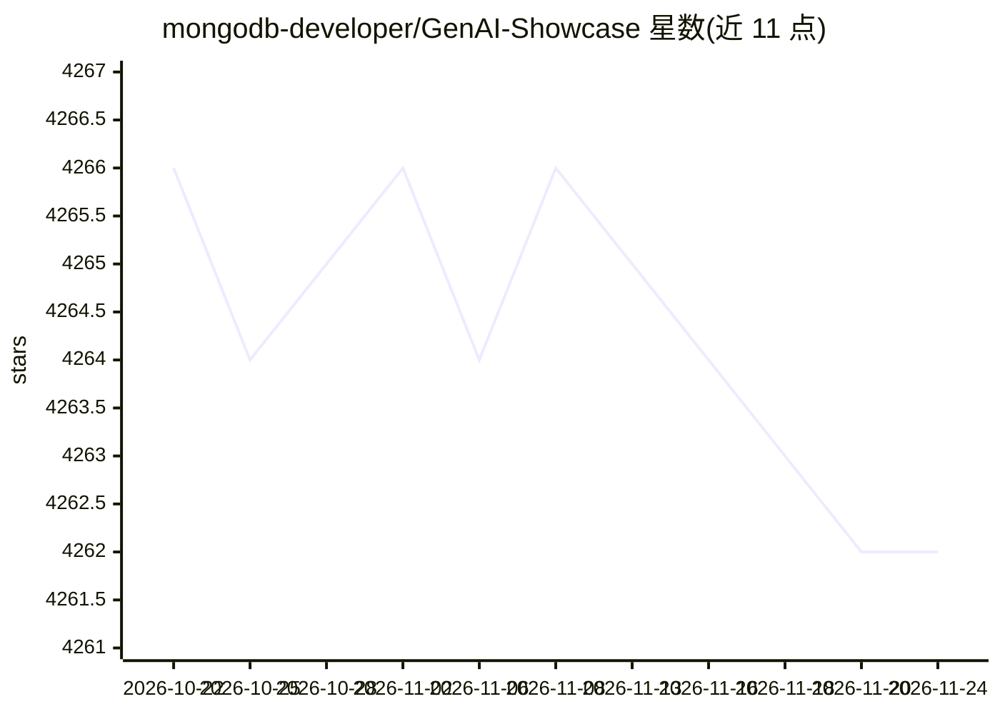

# mongodb-developer/GenAI-Showcase

⭐ 4,262 · Jupyter Notebook · MIT · 推送 2026-11-20 · [GitHub](https://github.com/mongodb-developer/GenAI-Showcase) · [官网](https://www.mongodb.com/cloud/atlas/register) · 组织维护

**面向开发者的 MongoDB GenAI 示例与样例应用合集**

MongoDB 官方维护的生成式 AI 示例仓库，收录覆盖 RAG、AI Agents 及行业场景的示例与样例应用，展示 MongoDB 在 RAG 管道与 Agent 中作为向量数据库、操作型数据库与记忆提供方的接入方式。运行仓库中的示例需连接 MongoDB 集群，可通过免费 Atlas 账号创建，或使用无需账号、有效期 48 小时的 Ephemeral Atlas Cluster。许可证为 MIT，问题通过 GitHub issue 反馈。

## 筛选速览

| 维度 | 判定 | 备注 |
|---|---|---|
| AI 角色 | `ai-knowledge` | 知识聚合/清单类 |
| 许可风险 | `permissive` | MIT |
| 部署形态 | `None` |  |
| 模型依赖 | — | README 未给出锁定关系 |
| 硬件要求 | — | 无带数字的原话,不猜 |
| 安装摩擦 | `low` | 无编译、无系统依赖或容器化 |
| 成熟度 | — | 结构信号不足 |

## 能力要点

- 覆盖 RAG、AI Agents 与行业用例的示例与样例应用合集
- 展示 MongoDB 作为向量数据库、操作型数据库与记忆提供方的用法
- 提供无需账号的 Ephemeral Atlas Cluster 快速上手途径（48 小时有效）

## 适用场景

- 学习如何在 RAG 管道中把 MongoDB 用作向量数据库
- 参考样例应用搭建行业特定的 GenAI 应用
- 了解 AI Agents 中数据库记忆层的接入方式

## 场景标签

`RAG` `教程课程` · 领域:知识与检索

## 证据(README 行号)

> L5: Whether you are just starting out on your Generative AI journey, or looking to build advanced GenAI applications, we
> L7: Discover how MongoDB integrates into RAG pipelines and AI Agents, serving as a vector database, operational database

## 星数曲线

2026-10-22 4,266 → 2026-11-24 4,262（-4）

---
*卡片 v1 · prompt 1.4 · 生成 2026-11-23 · 置信度 high · 依据 README sha `785bfa6f7c38` · [字段定义](../../DATASET.md)*
