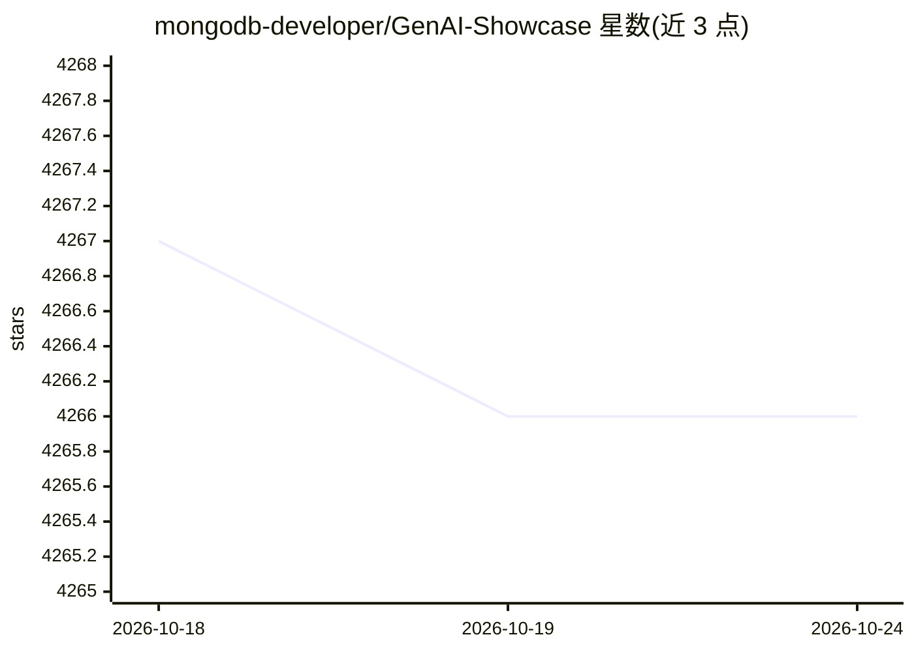

# mongodb-developer/GenAI-Showcase

⭐ 4,266 · Jupyter Notebook · MIT · 推送 2026-10-13 · [GitHub](https://github.com/mongodb-developer/GenAI-Showcase) · [官网](https://www.mongodb.com/cloud/atlas/register) · 组织维护

**MongoDB 官方 GenAI 示例与应用合集：RAG、AI Agents 等用例**

MongoDB 维护的生成式 AI 示例仓库，收录覆盖 RAG、AI Agents 与行业场景的示例与样例应用，展示 MongoDB 在 RAG 管道与 Agent 架构中作为向量数据库、业务数据库与记忆提供方的接入方式。运行任一示例需连接 MongoDB 集群：注册 MongoDB Atlas 账号、创建集群并获取连接字符串。面向学习与构建 GenAI 应用的开发者，MIT 许可。

## 筛选速览

| 维度 | 判定 | 备注 |
|---|---|---|
| AI 角色 | `ai-knowledge` | 知识聚合/清单类 |
| 许可风险 | `permissive` | MIT |
| 部署形态 | `None` |  |
| 模型依赖 | — | README 未给出锁定关系 |
| 硬件要求 | — | 无带数字的原话,不猜 |
| 安装摩擦 | `low` | 无编译、无系统依赖或容器化 |
| 成熟度 | — | 结构信号不足 |

## 能力要点

- 覆盖 RAG、AI Agents 与行业场景的示例与样例应用合集
- 演示 MongoDB 作为向量数据库/业务数据库/记忆提供方的集成方式
- 提供免费 MongoDB Atlas 起步流程

## 适用场景

- 学习如何把 MongoDB 接入 RAG 管道与 AI Agent 架构
- 查找行业场景的 GenAI 应用样例作为开发起点
- 了解 MongoDB 向量检索相关用例

## 场景标签

`RAG` `教程课程` · 领域:知识与检索

## 证据(README 行号)

> L5: Whether you are just starting out on your Generative AI journey, or looking to build advanced GenAI applications, we
> L7: Discover how MongoDB integrates into RAG pipelines and AI Agents, serving as a vector database, operational database

## 星数曲线

2026-10-18 4,267 → 2026-10-24 4,266（-1）

---
*卡片 v1 · prompt 1.4 · 生成 2026-10-20 · 置信度 high · 依据 README sha `75c7a67e66ea` · [字段定义](../../DATASET.md)*
