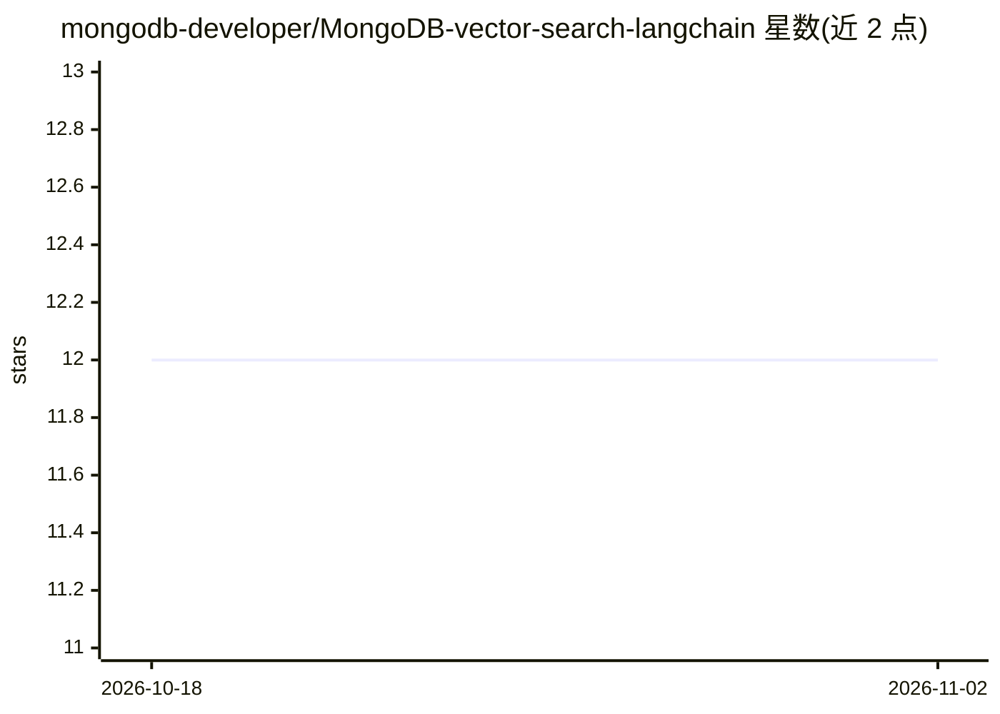

# mongodb-developer/MongoDB-vector-search-langchain

⭐ 12 · Jupyter Notebook · Apache-2.0 · 推送 2026-04-23 · [GitHub](https://github.com/mongodb-developer/MongoDB-vector-search-langchain) · 组织维护

**LangChain 与 MongoDB 向量检索集成的教学 Notebook**

由 mongodb-developer 组织维护的示例仓库，以 Jupyter Notebook（在 Google Colab 运行）演示将 LangChain 与 OpenAI 结合，把向量嵌入存入 MongoDB Atlas 文档，通过 MongoDB Vector Search 创建向量搜索索引并执行基于 HNSW 图的近似最近邻（ANN）相似度检索。内容还包括对比文本/模糊搜索与语义搜索，以及展示无检索架构的 LLM 与带检索架构输出差异。属于 RAG 集成教程性质，README 未给出本仓库的独立安装命令。

## 筛选速览

| 维度 | 判定 | 备注 |
|---|---|---|
| AI 角色 | `ai-knowledge` | 知识聚合/清单类 |
| 许可风险 | `permissive` | Apache-2.0 |
| 部署形态 | `None` |  |
| 模型依赖 | — | README 未给出锁定关系 |
| 硬件要求 | — | 无带数字的原话,不猜 |
| 安装摩擦 | `low` | 无编译、无系统依赖或容器化 |
| 成熟度 | — | 结构信号不足 |

## 能力要点

- 演示在 MongoDB Atlas 中创建向量搜索索引
- 存储向量嵌入并执行基于 HNSW 的 KNN 相似度检索
- 对比文本/模糊搜索与语义搜索
- 展示 LLM 在有无检索架构下的输出差异

## 适用场景

- 学习如何用 MongoDB Atlas 做 RAG 向量检索
- 参考 LangChain + MongoDB Vector Search 的集成方式
- 对比语义搜索与传统文本搜索效果

## 场景标签

`RAG` `教程课程` · 领域:知识与检索

## 证据(README 行号)

> L2: This Repo shows how to integrate LangChain, Open AI and store embeddings in the MongoDB Atlas and run a similarity s
> L4: ## The Notebook shows how to

## 星数曲线

2026-10-18 12 → 2026-11-02 12（+0）

---
*卡片 v1 · prompt 1.4 · 生成 2026-11-01 · 置信度 high · 依据 README sha `afe3ad9c180b` · [字段定义](../../DATASET.md)*
