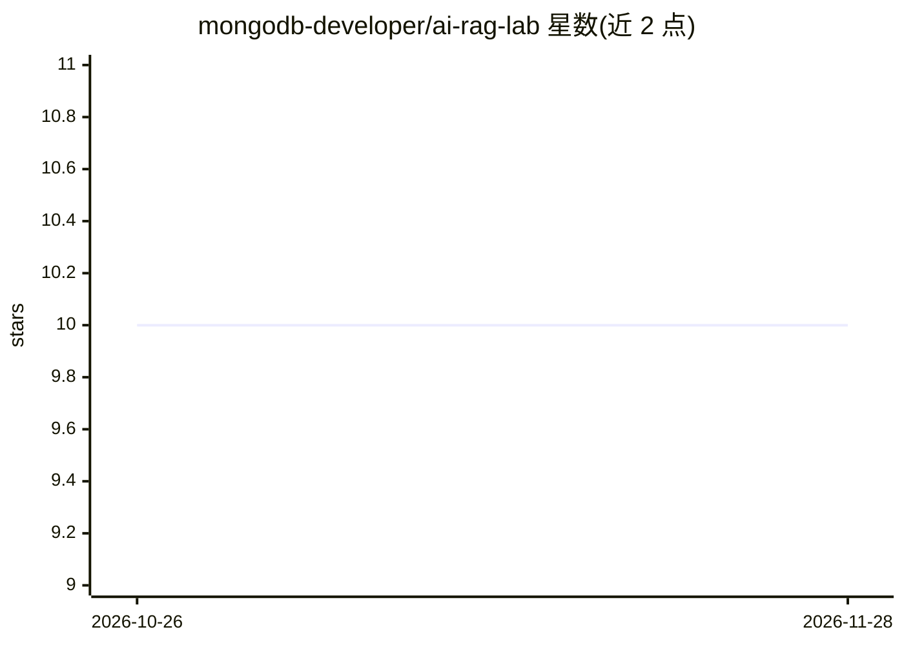

# mongodb-developer/ai-rag-lab

⭐ 10 · JavaScript · Apache-2.0 · 推送 2026-05-19 · [GitHub](https://github.com/mongodb-developer/ai-rag-lab) · 组织维护

**MongoDB Developer Days 构建 RAG 应用的实验教程**

这是 MongoDB Developer Days 使用的 RAG Lab，内容涵盖使用 MongoDB 构建 RAG 应用。仓库以 Node.js 编写，提供在线版本，也支持本地运行：克隆仓库后通过 npm install 安装依赖、npm start 启动服务，在 localhost:3000 访问实验环境。项目采用 Apache 2.0 许可，面向参加 Developer Days 或自学 RAG 构建的开发者。

## 筛选速览

| 维度 | 判定 | 备注 |
|---|---|---|
| AI 角色 | `ai-knowledge` | 知识聚合/清单类 |
| 许可风险 | `permissive` | Apache-2.0 |
| 部署形态 | `library` | 以包/库形式分发 |
| 模型依赖 | — | README 未给出锁定关系 |
| 硬件要求 | — | 无带数字的原话,不猜 |
| 安装摩擦 | `low` | 无编译、无系统依赖或容器化 |
| 成熟度 | — | 结构信号不足 |

## 能力要点

- 面向 MongoDB Developer Days 的 RAG 构建实验教程
- 提供在线版本与本地运行两种方式
- 基于 Node.js，npm install/npm start 即可启动

## 适用场景

- 参加 MongoDB Developer Days 时跟随实验操作
- 本地启动实验环境练习用 MongoDB 搭建 RAG 应用

## 场景标签

`RAG` `教程课程` · 领域:知识与检索

## 证据(README 行号)

> L3: # Developer Days RAG Lab
> L5: This is the RAG Lab used during MongoDB Developer Days that covers building RAG applications using MongoDB.
> L11: If you want to run the lab locally, you can start by cloning the repository or downloading the code. You will need 

## 星数曲线

2026-10-26 10 → 2026-11-28 10（+0）

---
*卡片 v1 · prompt 1.4 · 生成 2026-11-19 · 置信度 high · 依据 README sha `caf6f19b60ac` · [字段定义](../../DATASET.md)*
