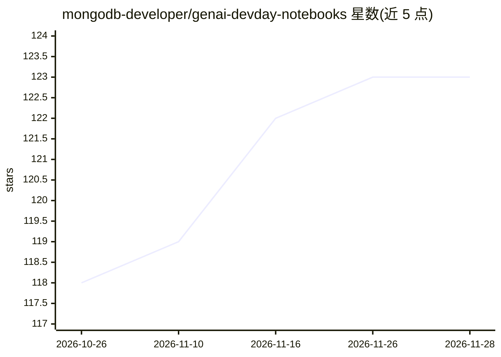

# mongodb-developer/genai-devday-notebooks

⭐ 123 · Jupyter Notebook · 推送 2026-11-25 · [GitHub](https://github.com/mongodb-developer/genai-devday-notebooks) · 组织维护

**MongoDB GenAI 开发者日的 Jupyter 教程合集**

该仓库收录 MongoDB GenAI Developer Day 活动所使用的全部 Jupyter Notebook 工作坊内容，主题标签涉及 MongoDB、RAG 与向量搜索，供参加或复现活动教程的开发者使用。README 仅提供活动索引入口，指引前往 Events 页面查找各城市举办的 Developer Day 活动；未给出独立的安装或运行说明，内容使用需结合活动安排。

## 筛选速览

| 维度 | 判定 | 备注 |
|---|---|---|
| AI 角色 | `ai-knowledge` | 知识聚合/清单类 |
| 许可风险 | `none` | — |
| 部署形态 | `None` |  |
| 模型依赖 | — | README 未给出锁定关系 |
| 硬件要求 | — | 无带数字的原话,不猜 |
| 安装摩擦 | `low` | 无编译、无系统依赖或容器化 |
| 成熟度 | — | 结构信号不足 |

## 能力要点

- 包含 GenAI Developer Day 全部工作坊 Jupyter Notebook
- 主题覆盖 MongoDB、RAG 与向量搜索
- README 指引 Events 页面查找线下活动

## 适用场景

- 参加 MongoDB GenAI Developer Day 前预习教程
- 以 Notebook 形式学习 MongoDB 上的 RAG 开发
- 复现活动中的工作坊示例

## 场景标签

`教程课程` `RAG` · 领域:知识与检索

## 证据(README 行号)

> L1: # MongoDB GenAI Developer Day Notebooks
> L2: This repository contains all the workshops delivered at MongoDB's GenAI Developer Days. To find Developer Days happe

## 星数曲线

2026-10-26 118 → 2026-11-28 123（+5）

---
*卡片 v1 · prompt 1.4 · 生成 2026-11-28 · 置信度 mid · 依据 README sha `a6208db462d8` · [字段定义](../../DATASET.md)*
