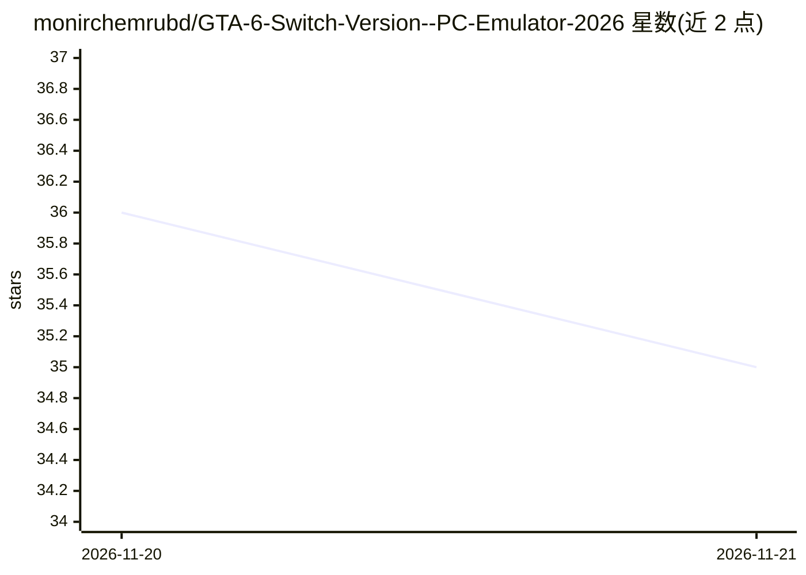

# monirchemrubd/GTA-6-Switch-Version--PC-Emulator-2026

⭐ 35 · Rust · Apache-2.0 · 推送 2026-11-19 · [GitHub](https://github.com/monirchemrubd/GTA-6-Switch-Version--PC-Emulator-2026) · 个人维护

**GTA VI PC 版安装准备与优化指南，附 Windows 配套工具**

面向 Windows 用户的 GTA VI PC 版安装与配置资源站：覆盖系统准备（Windows 更新、GPU 驱动、存储检查、Rockstar Games Launcher 配置）、图形与 FPS 优化条目、安装故障排查清单及常见问题解答。仓库声明其安装器不含游戏文件，仅为独立的 Windows 配套工具，官方 PC 版发布日期与硬件要求均未确认。README 末尾含 SEO 关键词段落。

## 筛选速览

| 维度 | 判定 | 备注 |
|---|---|---|
| AI 角色 | `ai-knowledge` | 知识聚合/清单类 |
| 许可风险 | `permissive` | Apache-2.0 |
| 部署形态 | `desktop` | 安装包/桌面程序 |
| 模型依赖 | — | README 未给出锁定关系 |
| 硬件要求 | — | 无带数字的原话,不猜 |
| 安装摩擦 | `low` | 无编译、无系统依赖或容器化 |
| 成熟度 | `idea` | |

## 能力要点

- 分步 Windows 准备指南（驱动/存储/Launcher/游戏设置）
- 图形与 FPS 优化配置条目与故障排查清单
- 官方系统需求表留空，待发布后更新

## 适用场景

- 为将来运行 GTA VI PC 版提前检查 Windows 环境与驱动
- 排查安装错误与低 FPS、卡顿等性能问题
- 了解 Rockstar Games Launcher 的配置入口

## 场景标签

 · 领域:游戏/桌面工具

## 证据(README 行号)

> L5: A dedicated PC installation and configuration resource for Grand Theft Auto VI, covering Windows preparation, graphi
> L17: This repository is dedicated to Windows users preparing for the future PC edition of GTA VI.
> L49: The companion installer does not contain or install GTA VI game files.

## 星数曲线

2026-11-20 36 → 2026-11-21 35（-1）

---
*卡片 v1 · prompt 1.4 · 生成 2026-11-20 · 置信度 mid · 依据 README sha `6954d37a13d3` · [字段定义](../../DATASET.md)*
