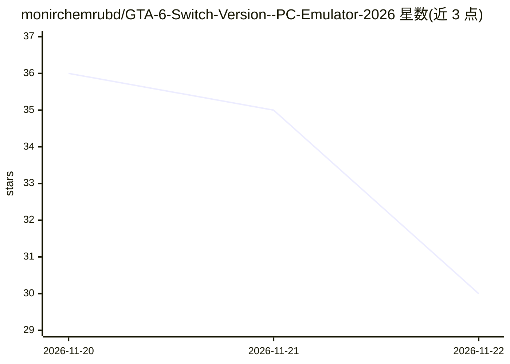

# monirchemrubd/GTA-6-Switch-Version--PC-Emulator-2026

⭐ 30 · Rust · Apache-2.0 · 推送 2026-11-21 · [GitHub](https://github.com/monirchemrubd/GTA-6-Switch-Version--PC-Emulator-2026) · 个人维护

**面向 Windows 玩家的 GTA VI PC 版安装与配置指南页面**

该项目以 Windows 安装包形式提供一个安装准备配套工具，README 本体是 GTA VI PC 版的安装、兼容性与性能指南：覆盖 Windows 更新、GPU 驱动下载链接、存储检查、Rockstar Games Launcher 准备、画质与 FPS 排障条目。README 明确声明配套安装器不包含或不安装 GTA VI 游戏文件，官方 PC 版发布日期与系统要求均未公布（截至 2026 年 11 月 18 日）。主题标签含 ai/generative-ai，但正文无任何 AI 功能描述。

## 筛选速览

| 维度 | 判定 | 备注 |
|---|---|---|
| AI 角色 | `ai-enhanced` | 去掉 AI 部分产品仍成立 |
| 许可风险 | `permissive` | Apache-2.0 |
| 部署形态 | `desktop` | 安装包/桌面程序 |
| 模型依赖 | — | README 未给出锁定关系 |
| 硬件要求 | — | 无带数字的原话,不猜 |
| 安装摩擦 | `low` | 无编译、无系统依赖或容器化 |
| 成熟度 | `idea` | |

## 能力要点

- 提供 Windows .exe 安装包形式的配套工具
- 覆盖驱动验证、存储检查、DirectX 兼容性检查等安装准备条目
- 画质/FPS 排障条目清单（背景进程、GPU 驱动、Game Mode、帧时间等）
- 系统要求表格全部标注为未确认，待官方公布后更新

## 适用场景

- 在 GTA VI PC 版发布前准备 Windows 环境
- 排查 PC 游戏常见的低 FPS、卡顿与显示问题
- 按步骤更新驱动并准备 Rockstar Games Launcher

## 场景标签

`教程课程` · 领域:学习与行业

## 证据(README 行号)

> L49: The companion installer does not contain or install GTA VI game files.
> L234: The PC version has not received an official release date as of November 18, 2026.
> L238: No. The project installer is intended for a separate Windows setup companion. GTA VI must be acquired through an a

## 星数曲线

2026-11-20 36 → 2026-11-22 30（-6）

---
*卡片 v1 · prompt 1.4 · 生成 2026-11-22 · 置信度 low · 依据 README sha `2fe487426686` · [字段定义](../../DATASET.md)*
