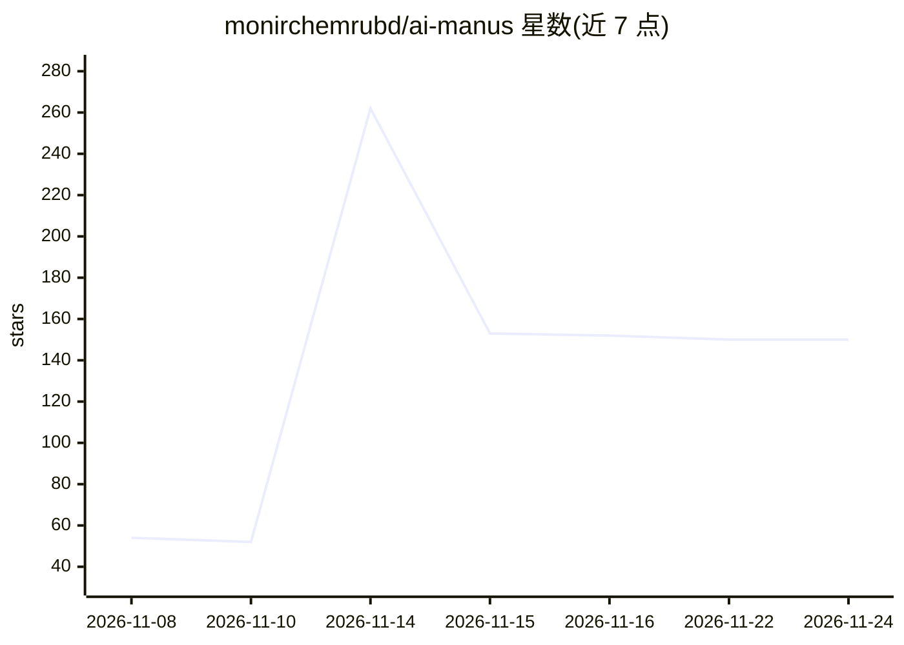

# monirchemrubd/ai-manus

⭐ 150 · Python · Apache-2.0 · 推送 2026-11-21 · [GitHub](https://github.com/monirchemrubd/ai-manus) · 个人维护

**面向日常任务的自主 AI Agent：自动执行代码与浏览器操作**

README 以产品宣传口吻描述：Manus 是自主 AI Agent，可在用户授权下执行脚本、控制浏览器（导航网页、填表、收集信息）并完成多步骤任务，定位为面向家庭、学习与轻量办公的个人助手，非企业平台。声称可跨会话记忆工作流模式。README 未给出任何代码仓库内容、安装命令或模型接入方式，仅提供硬件兼容表（最低 4GB 内存）与使用步骤描述，实际实现与获取渠道无法从 README 验证。

## 筛选速览

| 维度 | 判定 | 备注 |
|---|---|---|
| AI 角色 | `ai-native` | 本体是模型或模型工具 |
| 许可风险 | `permissive` | Apache-2.0 |
| 部署形态 | `None` |  |
| 模型依赖 | — | README 未给出锁定关系 |
| 硬件要求 | — | 无带数字的原话,不猜 |
| 安装摩擦 | `low` | 无编译、无系统依赖或容器化 |
| 成熟度 | — | 结构信号不足 |

## 能力要点

- 自主执行代码与脚本
- 浏览器控制：导航、填表、信息收集
- 多步骤任务与跨会话工作流记忆（README 声称）
- 硬件兼容表：最低双核 CPU、4GB 内存

## 适用场景

- 让代理代替自己完成重复性的网页操作与脚本执行
- 学生整理研究资料、跑小脚本
- 轻量办公中跨多页面收集信息并汇总

## 场景标签

`浏览器自动化` `AI 助手` · 领域:效率与自动化

## 证据(README 行号)

> L10: - **Autonomous Code Execution:** Manus AI agent runs code on its own to complete tasks, so you can focus on decisio
> L18: Manus is an autonomous AI agent designed to run code and control a browser on your behalf. Instead of acting like a

## 星数曲线

2026-11-08 54 → 2026-11-24 150（+96）

---
*卡片 v1 · prompt 1.4 · 生成 2026-11-18 · 置信度 low · 依据 README sha `18a40e84b5bf` · [字段定义](../../DATASET.md)*
