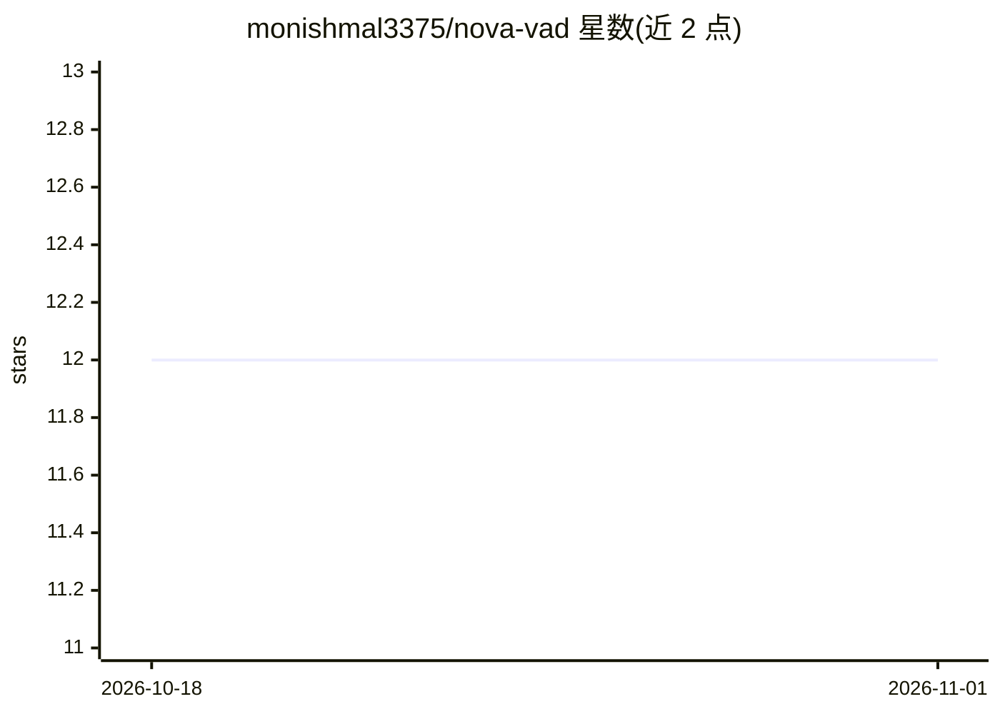

# monishmal3375/nova-vad

⭐ 12 · Python · MIT · 推送 2026-07-24 · [GitHub](https://github.com/monishmal3375/nova-vad) · 个人维护

**面向噪声音频的轻量可解释语音活动检测器（VAD）**

NOVA-VAD 是基于特征与 scikit-learn 集成的语音活动检测器，面向做 ASR、说话人分离、通话转录、边缘音频、机器人与实时语音代理的开发者，用于在送入下游前判定音频中是否存在语音。模型大小 1.6MB，无需 GPU，提供解释模块（explainer）与流式推理入口（stream）。README 报告在 3,295 文件留出集上 99.79% 准确率（对比 Silero VAD 94.87%），并详述了基准方法修正、时长混杂与训练/测试泄漏检查；结果范围限于该仓库自建的噪声音频测试集，非跨领域声明。

## 筛选速览

| 维度 | 判定 | 备注 |
|---|---|---|
| AI 角色 | `ai-native` | 本体是模型或模型工具 |
| 许可风险 | `permissive` | MIT |
| 部署形态 | `library` | 以包/库形式分发 |
| 模型依赖 | — | README 未给出锁定关系 |
| 硬件要求 | — | 无带数字的原话,不猜 |
| 安装摩擦 | `low` | 无编译、无系统依赖或容器化 |
| 成熟度 | — | 结构信号不足 |

## 能力要点

- 特征 + scikit-learn 集成分类器，模型 1.6MB，无需 GPU
- 提供 explainer 与 stream 两个推理入口，支持流式处理
- 在含 UrbanSound8K 十类噪声的自建留出集上报告 99.79% 准确率
- README 记录基准方法修正、时长混杂与泄漏检查过程

## 适用场景

- ASR 或转录流水线中先判断是否含语音再送下游
- 机器人/边缘设备上做实时语音活动检测
- 对比多个 VAD 基线并复现基准结果

## 场景标签

 · 领域:语音/音频处理

## 证据(README 行号)

> L5: NOVA-VAD is a lightweight, explainable Voice Activity Detector for noisy real-world audio.
> L7: It is built for people working on ASR, diarization, call transcription, edge audio, robotics, and realtime voice age
> L58: compare against them. The NOVA-VAD classifier itself is a feature-based scikit-learn

## 星数曲线

2026-10-18 12 → 2026-11-01 12（+0）

---
*卡片 v1 · prompt 1.4 · 生成 2026-11-01 · 置信度 mid · 依据 README sha `632448f49b27` · [字段定义](../../DATASET.md)*
