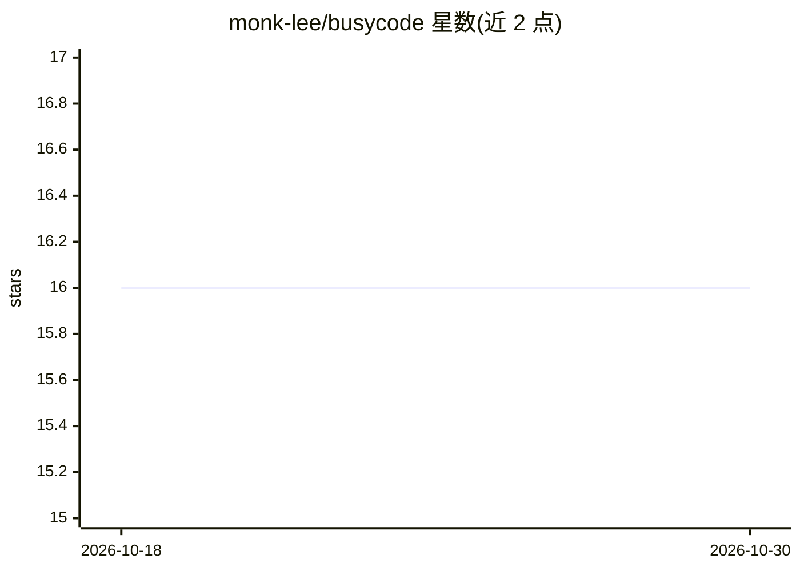

# monk-lee/busycode

⭐ 16 · TypeScript · MIT · 推送 2026-09-01 · [GitHub](https://github.com/monk-lee/busycode) · [官网](https://busycode.monklabs.dev/) · 个人维护

**让屏幕看起来像 AI 编码代理在工作的终端模拟器**

BusyCode 是一个模拟 AI agent CLI 的网页应用：在终端界面中重现探索、思考、编辑、验证代码库的操作画面，实际不执行任何编码任务。以 Vite + React 静态站点形式构建，部署为 Cloudflare Workers Static Assets，从 dist/ 目录提供静态资源、无需应用服务器。提供在线演示站点；README 声明不收集用户数据、不从浏览器调用外部 provider，且不发布 npm 包或签名发布产物。

## 筛选速览

| 维度 | 判定 | 备注 |
|---|---|---|
| AI 角色 | `ai-enhanced` | 去掉 AI 部分产品仍成立 |
| 许可风险 | `permissive` | MIT |
| 部署形态 | `library` | 以包/库形式分发 |
| 模型依赖 | — | README 未给出锁定关系 |
| 硬件要求 | — | 无带数字的原话,不猜 |
| 安装摩擦 | `low` | 无编译、无系统依赖或容器化 |
| 成熟度 | — | 结构信号不足 |

## 能力要点

- 模拟终端 agent 的探索/思考/编辑/验证操作画面
- 以 Cloudflare Workers Static Assets 部署静态资源，无需应用服务器
- 不收集用户数据、不从浏览器调用外部 provider
- 提供在线演示站点

## 适用场景

- 演示或录制时让终端呈现 agent 工作画面
- 娱乐/展示用途的终端动效

## 场景标签

 · 领域:演示/娱乐工具

## 证据(README 行号)

> L3: BusyCode is a fake AI agent CLI simulator. It recreates the feel of familiar terminal agents and immediately looks l
> L26: BusyCode is deployed as Cloudflare Workers Static Assets. Static assets are served from `dist/` without an applicat

## 星数曲线

2026-10-18 16 → 2026-10-30 16（+0）

---
*卡片 v1 · prompt 1.4 · 生成 2026-10-30 · 置信度 low · 依据 README sha `c1a5723047ea` · [字段定义](../../DATASET.md)*
