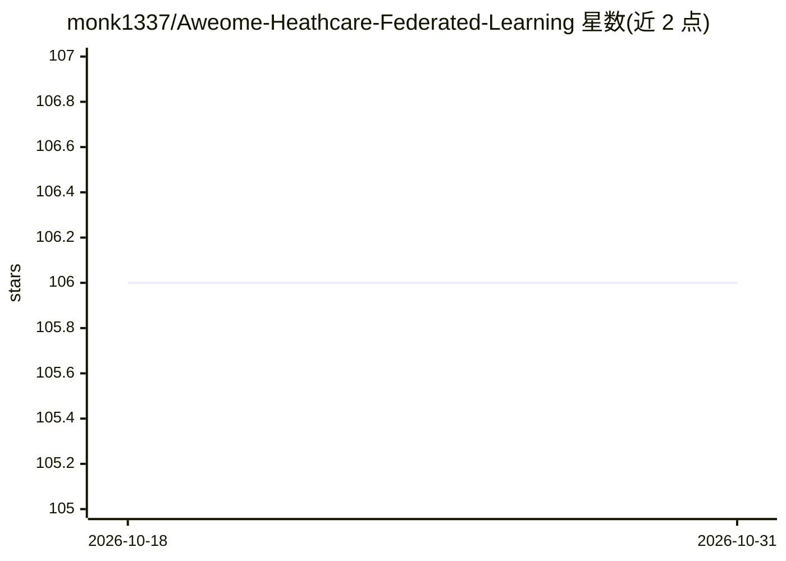

# monk1337/Aweome-Heathcare-Federated-Learning

⭐ 106 · 推送 2026-02-09 · [GitHub](https://github.com/monk1337/Aweome-Heathcare-Federated-Learning) · 个人维护

**医疗联邦学习论文与资源策展清单**

由个人维护的 awesome 清单，收录医疗健康领域联邦学习相关的论文、教程与开源代码资源。论文按 Survey、Covid-19、Experiments 等类别组织，覆盖电子健康记录、医学影像、EEG 信号、区块链隐私保护等主题；代码部分列出 TensorFlow Federated、FATE、Flower、PySyft 四个联邦学习框架，教程部分列出两门课程链接。仓库以鼓励 PR 贡献、按年份排序与分类整理为维护方式，MIT 许可。

## 筛选速览

| 维度 | 判定 | 备注 |
|---|---|---|
| AI 角色 | `ai-knowledge` | 知识聚合/清单类 |
| 许可风险 | `permissive` | — |
| 部署形态 | `None` |  |
| 模型依赖 | — | README 未给出锁定关系 |
| 硬件要求 | — | 无带数字的原话,不猜 |
| 安装摩擦 | `low` | 无编译、无系统依赖或容器化 |
| 成熟度 | — | 结构信号不足 |

## 能力要点

- 论文按 Survey/Covid-19/Experiments 等类别组织
- 列出 TensorFlow Federated、FATE、Flower、PySyft 等框架代码链接
- 覆盖 EHR、医学影像、EEG、区块链隐私保护等医疗场景论文

## 适用场景

- 查找医疗联邦学习领域的综述与研究论文
- 了解可用的联邦学习开源框架与教程
- 跟进 Covid-19 与医学影像场景下的联邦学习研究

## 场景标签

`精选清单` · 领域:学习与行业

## 证据(README 行号)

> L3: Federated learning, a mechanism of training a shared global model with a central server while keeping all the sensit
> L23: ## Code

## 星数曲线

2026-10-18 106 → 2026-10-31 106（+0）

---
*卡片 v1 · prompt 1.4 · 生成 2026-10-23 · 置信度 high · 依据 README sha `0a48f0f1906e` · [字段定义](../../DATASET.md)*
