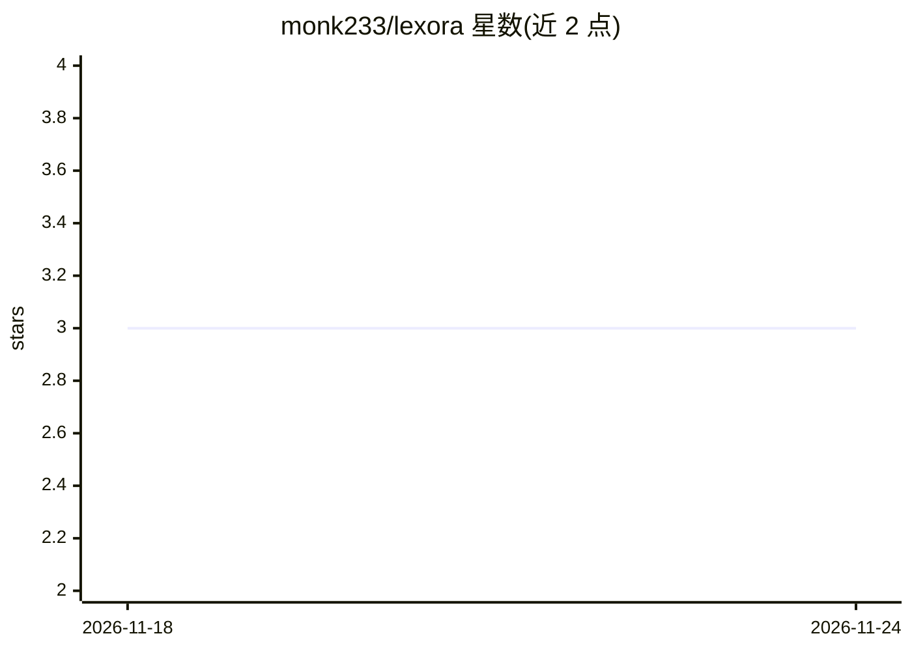

# monk233/lexora

⭐ 3 · Rust · MIT · 推送 2026-11-18 · [GitHub](https://github.com/monk233/lexora) · [官网](https://github.com/monk233/lexora) · 个人维护 · 中文 README

**Windows 划词翻译助手：选中即翻译/总结/解释/朗读**

基于 Tauri v2 + Rust 的 Windows 桌面划词工具，在浏览器、Word、PDF、IDE 等任意应用中选中文字后弹出浮动工具栏，提供翻译、总结、解释、润色、朗读、复制、搜索七类操作，结果流式输出并按 Markdown 渲染。支持云端任意 OpenAI 兼容接口，也可在应用内安装 llama.cpp 引擎离线运行 Qwen3.5 GGUF 模型（含视觉任务）。附带截图、标注、钉图、长截图、多轮追问、自定义技能等功能。以约 10.5 MB 便携单 exe 分发，免安装，仅支持 Windows 10/11。

## 筛选速览

| 维度 | 判定 | 备注 |
|---|---|---|
| AI 角色 | `ai-native` | 本体是模型或模型工具 |
| 许可风险 | `permissive` | MIT |
| 部署形态 | `desktop` | 安装包/桌面程序 |
| 模型依赖 | local-ok | 支持本地模型 |
| 硬件要求 | — | 无带数字的原话,不猜 |
| 安装摩擦 | `low` | 无编译、无系统依赖或容器化 |
| 成熟度 | — | 结构信号不足 |

## 能力要点

- 划选/双击/三击唤起工具栏，翻译、总结、解释、润色、朗读、搜索一站式
- 双引擎：任意 OpenAI 兼容云端接口 + 应用内 llama.cpp 本地 GGUF 离线运行
- 截图标注、OCR 提取、图片解释与钉在桌面、长截图拼接
- 自定义技能提示词，支持 {text}/{target}/{program} 变量

## 适用场景

- 阅读英文文档或网页时随手划词翻译和解释
- 断网或内网环境下用本地模型完成翻译与文本总结
- 截图取词并直接翻译、解释图片内容
- 在 IDE 里选中代码注释快速润色或解释

## 场景标签

`OCR` · 领域:感知与多模态

## 证据(README 行号)

> L15: Lexora 是 Windows 划词翻译工具。在浏览器、Word、PDF、IDE 等任意应用中选中文字后，光标旁出现浮动工具栏，提供翻译、总结、解释、润色、朗读、复制、搜索。工具栏为非激活浮层，不抢键盘焦点。
> L25: - **双引擎**：云端支持任意 OpenAI 兼容接口（DeepSeek / OpenAI / Moonshot / 智谱 / OpenCode Go / Ollama / LM Studio / 自建服务），可拉取模型列表；本

## 星数曲线

2026-11-18 3 → 2026-11-24 3（+0）

---
*卡片 v1 · prompt 1.4 · 生成 2026-11-21 · 置信度 mid · 依据 README sha `854996f98412` · [字段定义](../../DATASET.md)*
