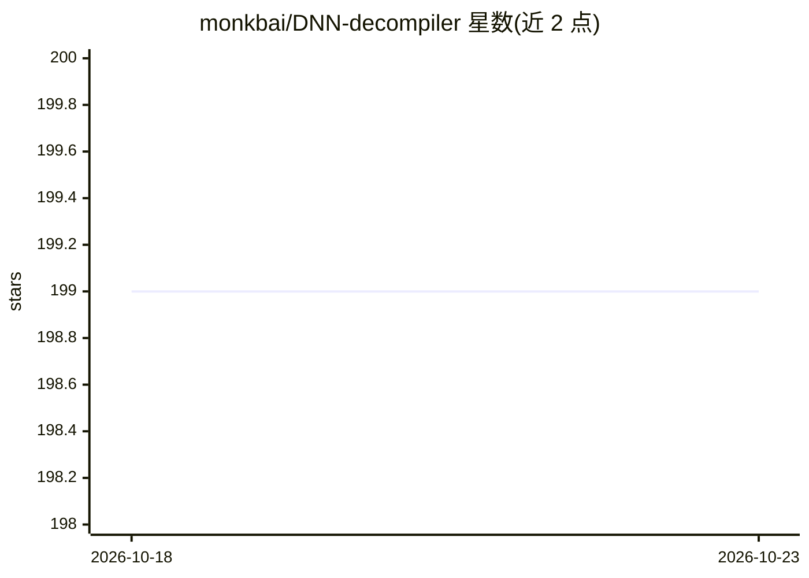

# monkbai/DNN-decompiler

⭐ 199 · Python · NOASSERTION · 推送 2026-03-13 · [GitHub](https://github.com/monkbai/DNN-decompiler) · 个人维护

**把 x86 DNN 可执行文件反编译还原为模型结构的学术工具**

USENIX Security 2023 论文 'Decompiling x86 Deep Neural Network Executables' 的研究工件：BTD 读取由 TVM、Glow、NNFusion 等 DNN 编译器生成并运行于 x86 CPU 的可执行文件，经 IDA Pro 反汇编与 Intel Pin 插桩收集指令轨迹后，推断 DNN 算子类型、网络拓扑、维度与参数，输出 JSON 格式的模型规格并用 PyTorch 重建验证。评测覆盖 7 个模型、9 种编译选项共 63 个可执行文件。限制：依赖商业软件 IDA Pro（可用其他反汇编工具替代但未提供代码）、轨迹收集单线程需一周且占约 1TB 磁盘；提供 Docker 镜像与数据集。面向安全研究/复现实验者。

## 筛选速览

| 维度 | 判定 | 备注 |
|---|---|---|
| AI 角色 | `ai-ecosystem` | LLM/agent 周边工具 |
| 许可风险 | `none` | NOASSERTION |
| 部署形态 | `desktop` | 安装包/桌面程序 |
| 模型依赖 | — | README 未给出锁定关系 |
| 硬件要求 | — | 无带数字的原话,不猜 |
| 安装摩擦 | `low` | 无编译、无系统依赖或容器化 |
| 成熟度 | — | 结构信号不足 |

## 能力要点

- 从 DNN 可执行文件恢复算子类型、拓扑、维度与参数
- 对算子融合、内存布局优化等编译优化保持稳健
- 提供 Docker 镜像与 63 个可执行文件的评测数据集
- 反编译结果以 PyTorch 重建并用相同输入验证输出一致性

## 适用场景

- 逆向分析编译后 DNN 可执行文件以恢复模型结构
- 复现 USENIX Security 2023 论文的实验结果
- 研究模型窃取/白盒攻击所需的模型参数提取

## 场景标签

`网络安全` · 领域:学习与行业

## 证据(README 行号)

> L5: BTD is the **first** deep neural network (DNN) executable decompiler. BTD takes DNN executables (running on x86 CPUs
> L3: Research Artifact for our **USENIX Security 2023** paper: "Decompiling x86 Deep Neural Network Executables"

## 星数曲线

2026-10-18 199 → 2026-10-23 199（+0）

---
*卡片 v1 · prompt 1.4 · 生成 2026-10-22 · 置信度 high · 依据 README sha `604051f19994` · [字段定义](../../DATASET.md)*
