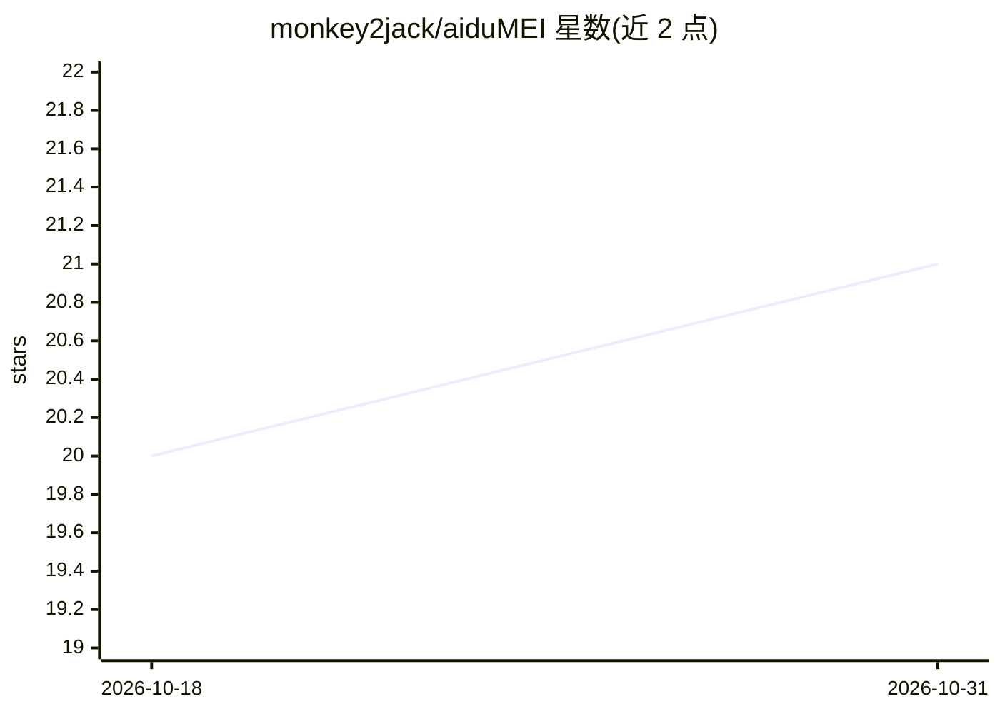

# monkey2jack/aiduMEI

⭐ 21 · Python · MIT · 推送 2026-10-30 · [GitHub](https://github.com/monkey2jack/aiduMEI) · 个人维护 · 中文 README

**给 AI Agent 用的单机自托管长期记忆引擎**

面向 Hermes / Claude Code / Codex CLI / Cursor 等 MCP 宿主的长期记忆服务：宿主管短期对话，aiduMEI 通过读写萃取三条钩子线负责记忆写入、混合检索（向量 + BM25/trigram + cross-encoder 重排）、六型分类、会话萃取与反思自进化。提供零构建 Web 控制台（/ui）、双引擎自动挡（云端断供降级本地）、认知治理（记忆出身/溯源打标）与 Markdown 导出。可选接入外部决策模型做分类与检索核验，可完全关闭。技术栈含 FastAPI、mem0、Qdrant、SQLite。README 声明处于功能快速迭代期，LoCoMo 试跑留证链缺失、不可第三方复现。MIT 许可。

## 筛选速览

| 维度 | 判定 | 备注 |
|---|---|---|
| AI 角色 | `ai-ecosystem` | LLM/agent 周边工具 |
| 许可风险 | `permissive` | MIT |
| 部署形态 | `self-host` | docker 或自建部署 |
| 模型依赖 | — | README 未给出锁定关系 |
| 硬件要求 | — | 无带数字的原话,不猜 |
| 安装摩擦 | `low` | 无编译、无系统依赖或容器化 |
| 成熟度 | `idea` | |

## 能力要点

- 读/写/萃取三条钩子线自动接管 Agent 的长期记忆，附接线验收脚本
- 混合检索：向量 + 中文 BM25/trigram + cross-encoder 重排，三轨遗忘曲线与双时间轴
- 零构建可视化控制台（/ui），记忆可见、可调、可导出 Markdown
- 双引擎自动挡：云端断供自动切本地备胎、恢复自动升挡

## 适用场景

- 给 Claude Code / Codex CLI / Hermes 等 Agent 挂上跨会话长期记忆
- 单机自托管部署记忆服务并通过 Web 控制台查看与治理记忆
- 用决策模型做记忆分类与检索证据核验（可选，可关闭）

## 场景标签

`Agent 记忆` · 领域:Agent 开发

## 证据(README 行号)

> L6: > 宿主（Hermes / Claude Code / Codex CLI / Cursor / 任何 MCP 客户端）管短期对话，aiduMEI 管长期记忆。
> L197: > | 写线 | `integrations/cursor-hook/claude-code-stop-hook.py` | Claude Code `Stop` | 同上 |

## 星数曲线

2026-10-18 20 → 2026-10-31 21（+1）

---
*卡片 v1 · prompt 1.4 · 生成 2026-10-28 · 置信度 mid · 依据 README sha `650d683d6d71` · [字段定义](../../DATASET.md)*
