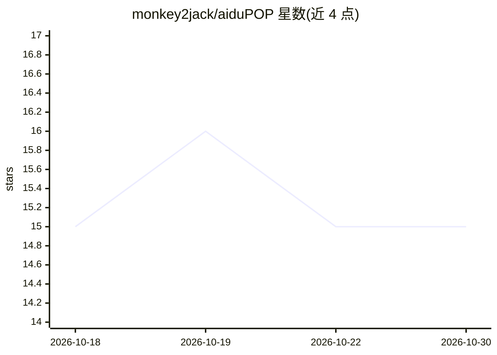

# monkey2jack/aiduPOP

⭐ 15 · Python · MIT · 推送 2026-10-14 · [GitHub](https://github.com/monkey2jack/aiduPOP) · 个人维护 · 中文 README

**Hermes Agent 的飞书流式卡片插件，实时渲染 AI 回答与思考**

基于 hermes-lark-streaming v1.6.0 改造的独立插件（非 fork 镜像），将 Hermes Agent 的回答与思考过程以飞书 CardKit 2.0 流式卡片实时呈现：首 token 即出卡片、打字机逐字输出、颜色编码状态（绿完成/红中止/黄报错）、可展开面板显示思考轮次与工具调用、原生 Clarify 交互选项卡。提供泡波样式主题与可视化配置工作坊 aidupop studio（本地 Web、所见即所得）。需 Hermes Agent 与飞书机器人，Python 3.11+，以 git clone 方式作为 Hermes 目录插件安装。

## 筛选速览

| 维度 | 判定 | 备注 |
|---|---|---|
| AI 角色 | `ai-ecosystem` | LLM/agent 周边工具 |
| 许可风险 | `permissive` | MIT |
| 部署形态 | `library` | 以包/库形式分发 |
| 模型依赖 | — | README 未给出锁定关系 |
| 硬件要求 | — | 无带数字的原话,不猜 |
| 安装摩擦 | `low` | 无编译、无系统依赖或容器化 |
| 成熟度 | — | 结构信号不足 |

## 能力要点

- 首 token 即渲染流式卡片，打字机逐字输出
- 可展开面板追踪思考轮次、工具调用与时间戳
- 原生飞书 Cardsuit 2.0 Clarify 交互选项卡与回调
- aidupop studio 可视化配置工作坊（本地运行、1:1 卡片预览）

## 适用场景

- 在飞书群里实时查看 Agent 的回答与推理过程
- 不写 YAML 即可调整卡片外观与 Emoji 图标
- AI 需要澄清时直接在飞书卡片内选择选项

## 场景标签

`聊天机器人` · 领域:对话与助手

## 证据(README 行号)

> L27: **aiduPOP☤爱嘟泡波卡**是 Hermes Agent 的飞书泡波卡插件 —— 让 AI 的回答和思考过程在飞书里实时、清晰、优雅地呈现。
> L29: **aiduPOP 是一个独立项目**（不是上游的 fork 镜像）—— 起源并致谢 Aowen-Nowor/hermes-lark-streaming v1.6.0，在其代码基础之上做了一套完整的**泡波样式（Bubble Wa
> L230: - **框架**：Hermes Agent by Nous Research

## 星数曲线

2026-10-18 15 → 2026-10-30 15（+0）

---
*卡片 v1 · prompt 1.4 · 生成 2026-10-30 · 置信度 mid · 依据 README sha `4571fdef9dcc` · [字段定义](../../DATASET.md)*
