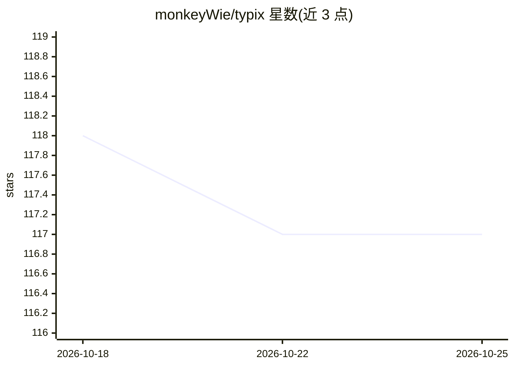

# monkeyWie/typix

⭐ 117 · TypeScript · Apache-2.0 · 推送 2026-02-06 · [GitHub](https://github.com/monkeyWie/typix) · [官网](https://typix.art/home) · 个人维护 · 中文 README

**免登录 AI 生图工具：集成多模型，可自托管部署**

面向 AI 创作者的图像生成 Web 应用：无需注册即可生成图像，集成 Google、OpenAI、Flux、Fal、Cloudflare 等 AI 服务商，支持 Cloudflare Workers AI 免费生图。数据基于浏览器本地 WASM SQLite 存储，客户端模式无服务器依赖，提供可选云同步。部署途径包括 Cloudflare Workers 一键部署、Docker 镜像运行与 Node.js 源码构建（Node.js 20+、pnpm、SQLite/Drizzle ORM）。采用 Apache License 2.0 协议。

## 筛选速览

| 维度 | 判定 | 备注 |
|---|---|---|
| AI 角色 | `ai-native` | 本体是模型或模型工具 |
| 许可风险 | `permissive` | Apache-2.0 |
| 部署形态 | `self-host` | docker 或自建部署 |
| 模型依赖 | — | README 未给出锁定关系 |
| 硬件要求 | — | 无带数字的原话,不猜 |
| 安装摩擦 | `low` | 无编译、无系统依赖或容器化 |
| 成熟度 | — | 结构信号不足 |

## 能力要点

- 免登录使用，免费调用 Cloudflare Workers AI 生图
- 集成 Google、OpenAI、Flux、Fal、Cloudflare 多家服务商
- 浏览器本地 WASM SQLite 存储，零数据上传
- 支持 Cloudflare Workers 一键部署与 Docker 部署

## 适用场景

- 免注册快速体验 FLUX、SDXL 等模型的 AI 生图
- 自托管部署一个完全掌控数据的生图服务
- 在多设备间同步创作内容

## 场景标签

`图像生成` · 领域:内容生成

## 证据(README 行号)

> L9: Typix 是一款现代化、开源、易用、隐私安全的 AI 工具，专注于媒体内容生成领域，为广大 AI 创作者提供一站式的生成体验，支持一键部署到 Cloudflare Workers 并且免费使用 Cloudflare Workers
> L22: 专注 AI 图像生成，让创意瞬间成为视觉艺术
> L26: - 🎁 **免费生图** - 免费使用 Cloudflare Workers AI 生图

## 星数曲线

2026-10-18 118 → 2026-10-25 117（-1）

---
*卡片 v1 · prompt 1.4 · 生成 2026-10-23 · 置信度 mid · 依据 README sha `9503557e8d66` · [字段定义](../../DATASET.md)*
