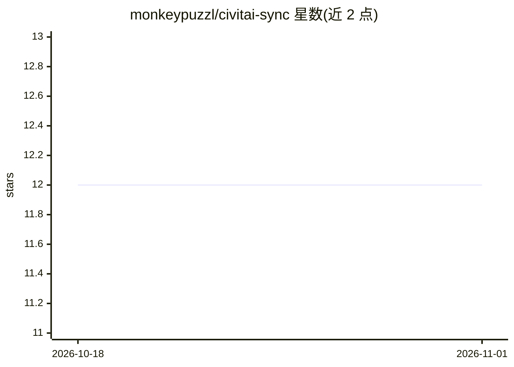

# monkeypuzzl/civitai-sync

⭐ 12 · JavaScript · NOASSERTION · 推送 2026-10-23 · [GitHub](https://github.com/monkeypuzzl/civitai-sync) · [官网](https://civitai.com/models/526058) · 个人维护

**下载并离线浏览 Civitai AI 作品的 CLI 与本地网站工具**

面向 Civitai 用户的下载与管理工具：通过 Civitai API 将用户的 generations、posts、comics 和 3D 内容下载到本地文件系统，按日期排序保存，支持 5 分钟到 1 天的定时自动下载与多账号配置。附带 Explorer 离线网站，可按评分、帖子标签和内容标签过滤浏览媒体并导出复用。由 Node.js 构建，要求 Node 18 及以上，通过 zip 下载或克隆仓库后 npm run setup 安装，需用户自建 Civitai API key。限制：Civitai 仅保留 generations 30 天，需定期下载。

## 筛选速览

| 维度 | 判定 | 备注 |
|---|---|---|
| AI 角色 | `ai-enhanced` | 去掉 AI 部分产品仍成立 |
| 许可风险 | `none` | NOASSERTION |
| 部署形态 | `desktop` | 安装包/桌面程序 |
| 模型依赖 | — | README 未给出锁定关系 |
| 硬件要求 | — | 无带数字的原话,不猜 |
| 安装摩擦 | `low` | 无编译、无系统依赖或容器化 |
| 成熟度 | — | 结构信号不足 |

## 能力要点

- 下载 generations/posts/comics/3D，按日期排序存为文件
- Explorer 离线网站：浏览、搜索、按评分与标签过滤、导出媒体
- 5 分钟至 1 天间隔的自动下载与多账号支持
- 软件自动更新与手动更新途径

## 适用场景

- 把我在 Civitai 上的生成作品定期备份到本地
- 离线浏览和检索我的作品库并复用媒体
- 管理多个 Civitai 账号的下载

## 场景标签

`网页抓取` · 领域:效率与自动化

## 证据(README 行号)

> L3: civitai-sync is a tool to download and explore your Civitai creations.
> L5: * Download generations, posts, comics, and 3D

## 星数曲线

2026-10-18 12 → 2026-11-01 12（+0）

---
*卡片 v1 · prompt 1.4 · 生成 2026-11-01 · 置信度 high · 依据 README sha `f9be5ebbdf98` · [字段定义](../../DATASET.md)*
