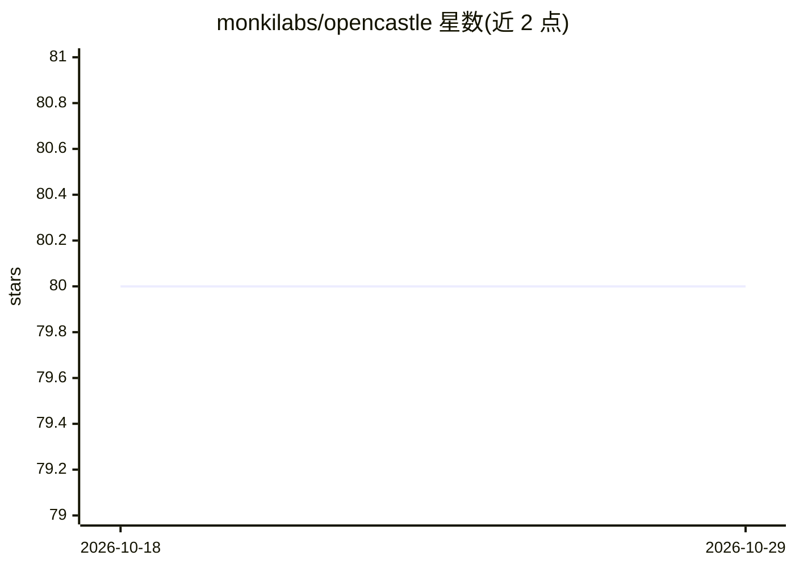

# monkilabs/opencastle

⭐ 80 · TypeScript · MIT · 推送 2026-10-20 · [GitHub](https://github.com/monkilabs/opencastle) · [官网](http://www.opencastle.dev/) · 组织维护

**团队 AI 编程助手的共享记忆与配置编译层**

面向使用 AI 编程助手的团队：把指令、技能、agents 以各助手原生格式编译进仓库，使 Claude Code、GitHub Copilot、Cursor、Windsurf、OpenCode、Codex、Antigravity 等共享同一套配置与记忆。机制上通过 agent 停止时的钩子把项目相关记忆转为课程文件、随 PR 审查、下次任务前自动加载；提供基线 npm 包、策略收紧、lockfile 审查与 CI 检查。Convoy 多步执行引擎标注为实验性，编译器不依赖它。运行需 Node.js 22.5+。

## 筛选速览

| 维度 | 判定 | 备注 |
|---|---|---|
| AI 角色 | `ai-ecosystem` | LLM/agent 周边工具 |
| 许可风险 | `permissive` | MIT |
| 部署形态 | `library` | 以包/库形式分发 |
| 模型依赖 | locked-api |  |
| 硬件要求 | — | 无带数字的原话,不猜 |
| 安装摩擦 | `low` | 无编译、无系统依赖或容器化 |
| 成熟度 | `idea` | |

## 能力要点

- 配置编译为 7 种助手的原生格式，切换助手保留设置与记忆
- agent 记忆经钩子转为课程、随 PR 审查并自动加载
- 13 个角色 agents、17 个领域技能、33 个工具集成按需编译
- Convoy 引擎可并行执行多步任务（实验性）

## 适用场景

- 让团队所有成员的 AI 助手共享项目知识与规范
- 新成员克隆仓库后助手即具备资深者上下文
- 在 CI 中检查助手配置漂移并审查变更影响

## 场景标签

`Agent 记忆` · 领域:Agent 开发

## 证据(README 行号)

> L26: OpenCastle makes it the team's. Instructions, skills and agents live in the
> L37: **With the tools you have, or on its own.** OpenCastle runs no agent, no
> L118: |**Claude Code**|`CLAUDE.md`, `.claude/agents/`, commands in `.claude/commands/oc/`|`.claude/skills/`|`.mcp.json`|

## 星数曲线

2026-10-18 80 → 2026-10-29 80（+0）

---
*卡片 v1 · prompt 1.4 · 生成 2026-10-24 · 置信度 high · 依据 README sha `a1f5c292f60b` · [字段定义](../../DATASET.md)*
