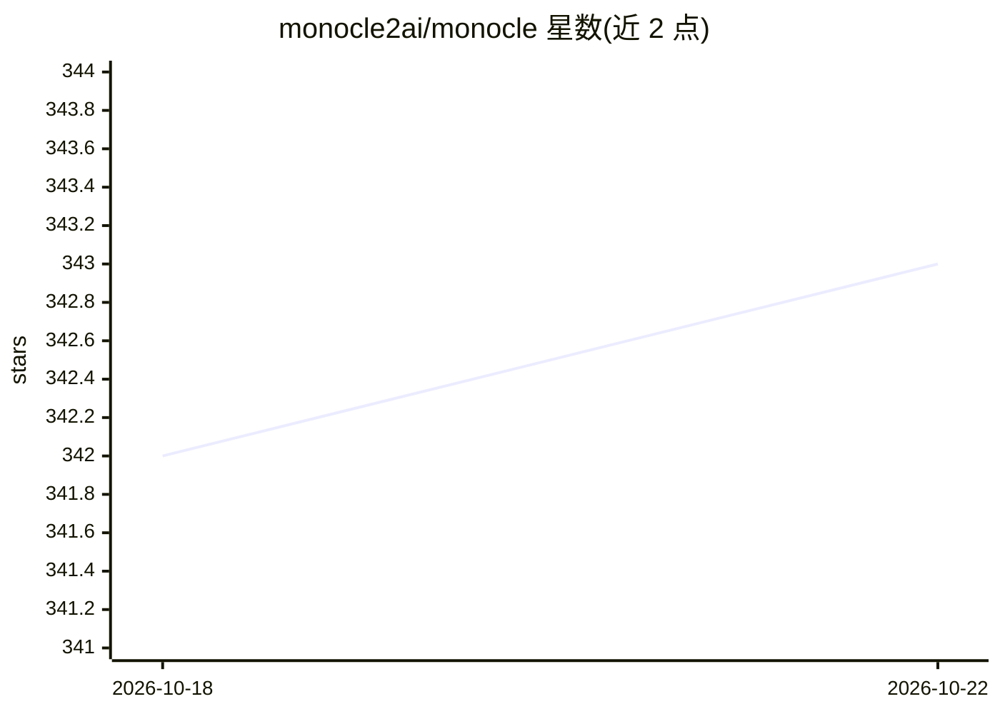

# monocle2ai/monocle

⭐ 343 · Python · Apache-2.0 · 推送 2026-10-21 · [GitHub](https://github.com/monocle2ai/monocle) · [官网](http://monocle2ai.org) · 组织维护

**GenAI 应用与 agent 的 OpenTelemetry 追踪与测试框架**

Linux Foundation AI & Data 孵化下的开源可观测性框架，Python 实现（monocle_apptrace）：通过 GenAI 元模型与各框架的自动插桩适配器，为 agent 运行、工具调用、LLM 调用、向量检索生成 OTLP 标准 span，导出到本地 JSON 文件、控制台或任意 OTel 后端。配套 monocle-test-tools 提供 pytest 风格的基于 trace 的断言测试。支持零/低代码接入（包装模式、AI 编码助手 CLI hook），默认开启敏感信息脱敏。

## 筛选速览

| 维度 | 判定 | 备注 |
|---|---|---|
| AI 角色 | `ai-ecosystem` | LLM/agent 周边工具 |
| 许可风险 | `permissive` | Apache-2.0 |
| 部署形态 | `library` | 以包/库形式分发 |
| 模型依赖 | — | README 未给出锁定关系 |
| 硬件要求 | — | 无带数字的原话,不猜 |
| 安装摩擦 | `low` | 无编译、无系统依赖或容器化 |
| 成熟度 | — | 结构信号不足 |

## 能力要点

- 自动为 LangChain/LlamaIndex/Haystack/Google ADK 等框架生成 OTel span
- monocle-test-tools 基于 trace 断言工具调用、token 成本、agent 行为
- 默认导出本地 JSON，兼容任意 OTLP 后端
- 默认开启 span 脱敏（API key/密码/token/私钥），支持环境变量扩展规则

## 适用场景

- 追踪多 agent 应用中每次模型调用、工具调用与中间状态
- 在 CI/CD 中对 AI agent 行为做基于 trace 的回归测试
- 平台团队不改业务代码即可注入追踪（包装模式/Lambda 层）
- 通过 hook 追踪 Claude CLI、Codex CLI、GitHub Copilot 的编码会话

## 场景标签

`LLM 可观测性` · 领域:评测与运维

## 证据(README 行号)

> L28: At its core, Monocle is a **GenAI-specific observability layer built on OpenTelemetry**.
> L39: * 🧩 **Works with the GenAI stack you already use** — LangChain, LlamaIndex, Haystack, Google ADK, OpenAI, Anthropic

## 星数曲线

2026-10-18 342 → 2026-10-22 343（+1）

---
*卡片 v1 · prompt 1.4 · 生成 2026-10-21 · 置信度 high · 依据 README sha `a2b663dc61d0` · [字段定义](../../DATASET.md)*
