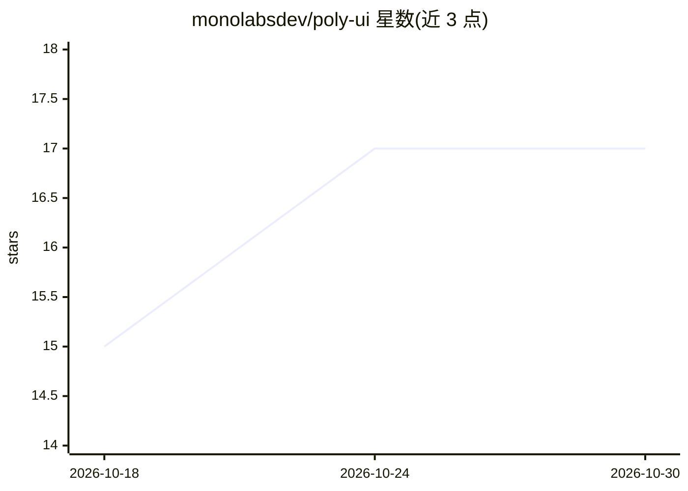

# monolabsdev/poly-ui

⭐ 17 · JavaScript · MIT · 推送 2026-08-10 · [GitHub](https://github.com/monolabsdev/poly-ui) · [官网](https://www.polyui.co.uk/) · 组织维护

**本地模型与云端供应商聚合的桌面 AI 对话客户端**

基于 React 与 Tauri 的桌面应用，将本地模型服务器（Ollama、LM Studio）、自带 API key 的云端供应商（OpenAI、Anthropic、Gemini、OpenRouter 等）及本地编码代理（Claude Code、Codex）聚合到单一界面。对话数据存于本地 SQLite，凭证存于操作系统钥匙串，会话默认只读、工作区修改与命令执行需显式批准。技术栈包含 Rust 原生服务与私有 Bun sidecar（Vercel AI SDK 运行时）。提供 macOS/Windows/Linux 安装包与命令行安装脚本。

## 筛选速览

| 维度 | 判定 | 备注 |
|---|---|---|
| AI 角色 | `ai-ecosystem` | LLM/agent 周边工具 |
| 许可风险 | `permissive` | MIT |
| 部署形态 | `desktop` | 安装包/桌面程序 |
| 模型依赖 | local-ok | 支持本地模型 |
| 硬件要求 | — | 无带数字的原话,不猜 |
| 安装摩擦 | `low` | 无编译、无系统依赖或容器化 |
| 成熟度 | — | 结构信号不足 |

## 能力要点

- 本地模型与多家云端供应商统一接入，可选请求运行位置
- 对话存本地 SQLite，凭证存操作系统钥匙串
- Claude Code 与 Codex 编码代理集成，编辑与命令执行需显式批准
- 连接本地模型服务器时可完全离线运行

## 适用场景

- 在一个桌面应用中切换使用本地模型与云端供应商
- 在本地受控地运行 Claude Code / Codex 编码代理
- 在保持数据不出设备的前提下进行 AI 对话

## 场景标签

`聊天机器人` · 领域:对话与助手

## 证据(README 行号)

> L28: PolyUI brings local models, bring-your-own-key cloud providers, and local coding agents into one focused desktop ap
> L32: - **Local or hosted models.** Use Ollama, LM Studio, or another local model server, or connect OpenAI, Anthropic, G
> L33: - **Coding agents in your workspace.** Run Claude Code and Codex with their existing CLI logins. Sessions start rea

## 星数曲线

2026-10-18 15 → 2026-10-30 17（+2）

---
*卡片 v1 · prompt 1.4 · 生成 2026-10-29 · 置信度 high · 依据 README sha `2b2495b1b0a5` · [字段定义](../../DATASET.md)*
