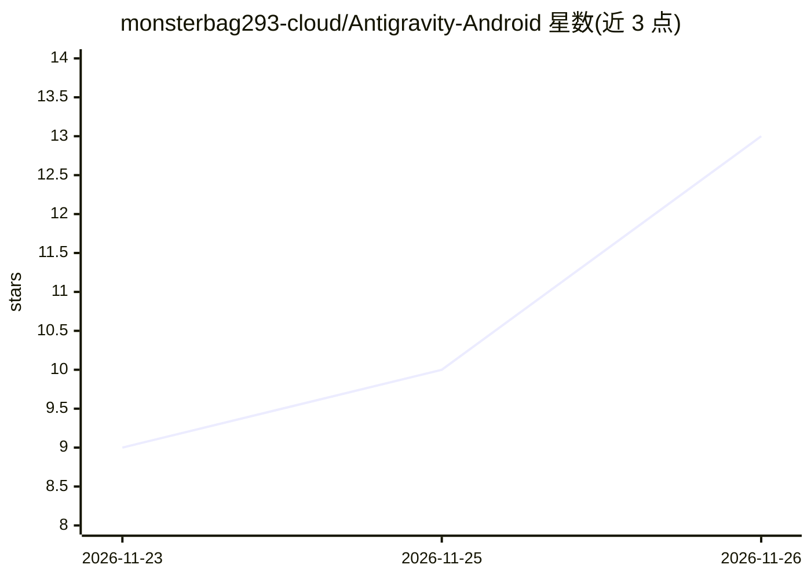

# monsterbag293-cloud/Antigravity-Android

⭐ 13 · Kotlin · 推送 2026-11-24 · [GitHub](https://github.com/monsterbag293-cloud/Antigravity-Android) · 个人维护

**在 Android 上原生运行 Google Antigravity agent 工作区的非官方移植**

Google Antigravity 的非官方 Android 移植与移动兼容运行时，开发者可在手机/平板上直接运行 Antigravity 的自主 agent 环境与工作区，无需桌面端。内置 Debian 12 ARM64 PRoot 环境，本地运行语言服务器、gRPC-Web 代理流、Python 3.12、Node.js v22 与 Git；提供 Swarm 界面、定时自动化、项目/对话分离存储、语音输入、沙箱代码执行，以及 Marketplace 插件安装与外部 OAuth（Google Drive、GitHub）。安装走 GitHub Releases APK 或 ADB，亦可从源码构建。声明与 Google 无隶属关系。

## 筛选速览

| 维度 | 判定 | 备注 |
|---|---|---|
| AI 角色 | `ai-ecosystem` | LLM/agent 周边工具 |
| 许可风险 | `none` | — |
| 部署形态 | `desktop` | 安装包/桌面程序 |
| 模型依赖 | — | README 未给出锁定关系 |
| 硬件要求 | — | 无带数字的原话,不猜 |
| 安装摩擦 | `medium` | 含编译或系统依赖之一 |
| 成熟度 | — | 结构信号不足 |

## 能力要点

- PRoot 环境内本地运行 Python 3.12、Node.js v22、Git 与语言服务器
- Swarm 界面与持久化定时自动化，附 Android 通知展示助手响应
- 项目文件与对话数据库分离存储，移动端触控侧栏与手势交互
- Marketplace 一键安装插件与 Chrome Custom Tabs 外部 OAuth

## 适用场景

- 在 Android 手机/平板上使用 Antigravity agent 工作区
- 移动端本地管理项目文件与沙箱代码执行
- 通过定时自动化在移动设备上持续运行任务

## 场景标签

`编码 Agent` · 领域:编码与开发

## 证据(README 行号)

> L8: An unofficial native Android port and mobile compatibility runtime for **Google Antigravity**, allowing developers t
> L34: - **Native PRoot & Language Server Runtime**: Runs local language servers, gRPC-Web proxy streams, Python 3.12, Nod

## 星数曲线

2026-11-23 9 → 2026-11-26 13（+4）

---
*卡片 v1 · prompt 1.4 · 生成 2026-11-23 · 置信度 high · 依据 README sha `0ddf6ba24b3c` · [字段定义](../../DATASET.md)*
