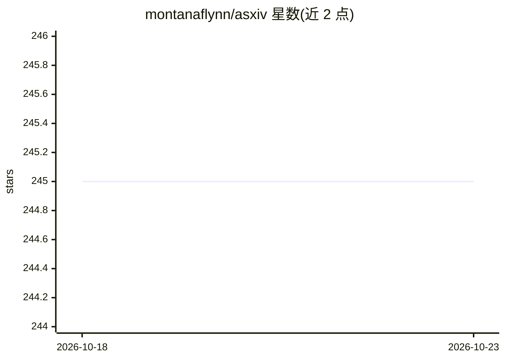

# montanaflynn/asxiv

⭐ 245 · TypeScript · 推送 2026-05-12 · [GitHub](https://github.com/montanaflynn/asxiv) · [官网](https://asxiv.org) · 个人维护

**用 AI 对话探索和理解 arXiv 论文的 Web 界面**

基于 Next.js/TypeScript 的 Web 应用，在浏览器中打开 arXiv 论文 PDF 并通过聊天界面与 AI 讨论论文内容。模型层接 Google Gemini API（需自备 API key，可选 gemini-2.5-flash-lite/flash/pro 三档），AI 回答中的页码引用 (page N) 会被转换为可点击链接，直接跳转到 PDF 对应页。面向需要阅读和理解 arXiv 论文的研究者与开发者，通过 git clone 源码与 npm 安装依赖后本地运行，无桌面安装包。

## 筛选速览

| 维度 | 判定 | 备注 |
|---|---|---|
| AI 角色 | `ai-native` | 本体是模型或模型工具 |
| 许可风险 | `none` | — |
| 部署形态 | `library` | 以包/库形式分发 |
| 模型依赖 | — | README 未给出锁定关系 |
| 硬件要求 | — | 无带数字的原话,不猜 |
| 安装摩擦 | `low` | 无编译、无系统依赖或容器化 |
| 成熟度 | — | 结构信号不足 |

## 能力要点

- PDF 论文内嵌聊天界面，页码引用自动转为可点击跳转链接
- 支持可选配 gemini-2.5-flash-lite / flash / pro 三档模型
- Next.js 项目，提供 dev/build/start/lint 脚本

## 适用场景

- 阅读 arXiv 论文时向 AI 提问并跳转到引用页
- 快速定位论文中与问题相关的页面
- 本地部署一个论文阅读与问答的 Web 界面

## 场景标签

`文档问答` `科研工具` · 领域:知识与检索

## 证据(README 行号)

> L3: > An intelligent AI-powered interface for exploring and understanding arXiv research papers
> L72: │   ├── ChatWidget.tsx     # Main chat interface

## 星数曲线

2026-10-18 245 → 2026-10-23 245（+0）

---
*卡片 v1 · prompt 1.4 · 生成 2026-10-22 · 置信度 high · 依据 README sha `e79e48139838` · [字段定义](../../DATASET.md)*
