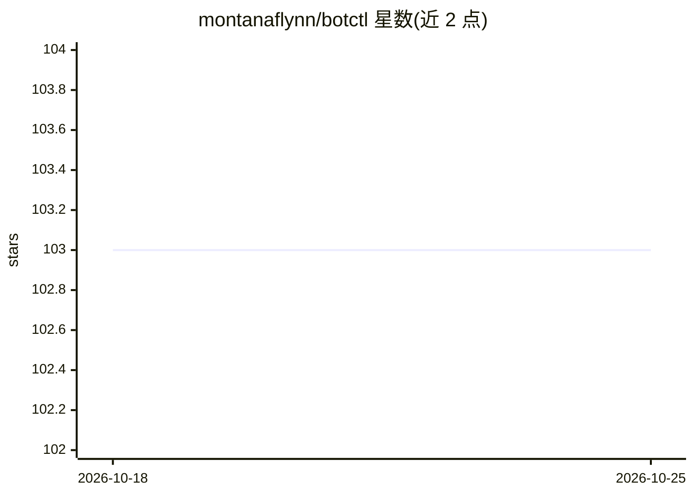

# montanaflynn/botctl

⭐ 103 · Go · 推送 2026-04-23 · [GitHub](https://github.com/montanaflynn/botctl) · [官网](https://botctl.dev) · 个人维护

**自治 AI agent 机器人的进程管理器：CLI/TUI/Web 看板统一运行持久化 bot**

用单个 CLI 管理多个持久运行的自治 AI agent：提供终端 dashboard（TUI）、Web 看板与 BOT.md 声明式配置（YAML frontmatter 加 markdown 正文作为系统提示）。默认后端为 Claude，可切换 opencode 后端接入 OpenRouter、OpenAI、Gemini、本地 Ollama 等提供商。bot 具备 running/sleeping/paused/stopped 四态循环、暂停保留会话、技能（SKILL.md）三层发现与按需加载，配置改动下次运行即生效。支持 curl 脚本、Homebrew、go install 安装及预编译二进制，MIT 许可。

## 筛选速览

| 维度 | 判定 | 备注 |
|---|---|---|
| AI 角色 | `ai-ecosystem` | LLM/agent 周边工具 |
| 许可风险 | `none` | — |
| 部署形态 | `desktop` | 安装包/桌面程序 |
| 模型依赖 | local-ok | 支持本地模型 |
| 硬件要求 | — | 无带数字的原话,不猜 |
| 安装摩擦 | `low` | 无编译、无系统依赖或容器化 |
| 成熟度 | — | 结构信号不足 |

## 能力要点

- BOT.md 声明式配置：YAML frontmatter 定义运行参数，markdown 正文作为系统提示
- 可插拔后端：默认 Claude，切换 opencode 可用 OpenRouter/Gemini/本地 Ollama 等提供商
- 四状态生命周期（running/sleeping/paused/stopped），暂停保留会话上下文
- SKILL.md 技能三层发现与 agent 按需加载，可从社区仓库安装技能

## 适用场景

- 长期运行多个自治 agent 并在终端 dashboard 中统一监控启停
- 通过 Web 看板远程管理 bot 状态与日志
- 以声明式文件定义并复用 agent 配置与技能

## 场景标签

`Agent 框架` · 领域:Agent 开发

## 证据(README 行号)

> L8: Process manager for autonomous AI agent bots. Run persistent agents from a single CLI with a terminal dashboard, web
> L10: Pluggable agent backends: runs on Claude out of the box, or swap in opencode to use OpenRouter, OpenAI, Gemini, loc
> L102: |`backend`|string|`claude`|Agent runtime: `claude` or `opencode`|

## 星数曲线

2026-10-18 103 → 2026-10-25 103（+0）

---
*卡片 v1 · prompt 1.4 · 生成 2026-10-23 · 置信度 high · 依据 README sha `d78f67ce6900` · [字段定义](../../DATASET.md)*
