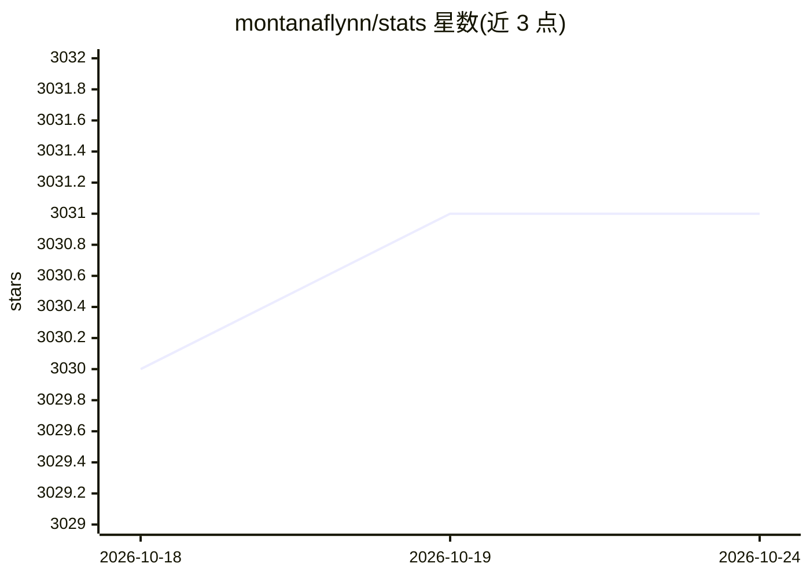

# montanaflynn/stats

⭐ 3,031 · Go · MIT · 推送 2026-10-24 · [GitHub](https://github.com/montanaflynn/stats) · 个人维护

**无依赖的 Go 语言统计学函数库**

以 Go 包形式提供的统计学函数库，覆盖中位数、百分位、相关性等统计计算，无第三方依赖。供需要在 Go 程序中进行数值与统计分析的开发者使用，通过 go get 安装，API 文档发布于 pkg.go.dev，也可用 go doc 离线查看。项目采用 MIT 许可，发布流程由 GoReleaser 与 GitHub Actions 自动化，贡献需遵循 Conventional Commits 规范。

## 筛选速览

| 维度 | 判定 | 备注 |
|---|---|---|
| AI 角色 | `ai-native` | 本体是模型或模型工具 |
| 许可风险 | `permissive` | MIT |
| 部署形态 | `None` |  |
| 模型依赖 | — | README 未给出锁定关系 |
| 硬件要求 | — | 无带数字的原话,不猜 |
| 安装摩擦 | `low` | 无编译、无系统依赖或容器化 |
| 成熟度 | — | 结构信号不足 |

## 能力要点

- 提供中位数、百分位、相关系数等统计函数
- 无第三方依赖
- API 文档发布于 pkg.go.dev 并支持 go doc 离线查看

## 适用场景

- 在 Go 程序中直接调用统计函数处理 float64 数据
- 数据分析与科学计算场景的数值统计
- 需要零依赖、易于引入的统计计算包

## 场景标签

 · 领域:数据分析/统计

## 证据(README 行号)

> L5: A well tested and comprehensive Golang statistics library / package / module with no dependencies.

## 星数曲线

2026-10-18 3,030 → 2026-10-24 3,031（+1）

---
*卡片 v1 · prompt 1.4 · 生成 2026-10-20 · 置信度 low · 依据 README sha `0e5356f2069f` · [字段定义](../../DATASET.md)*
