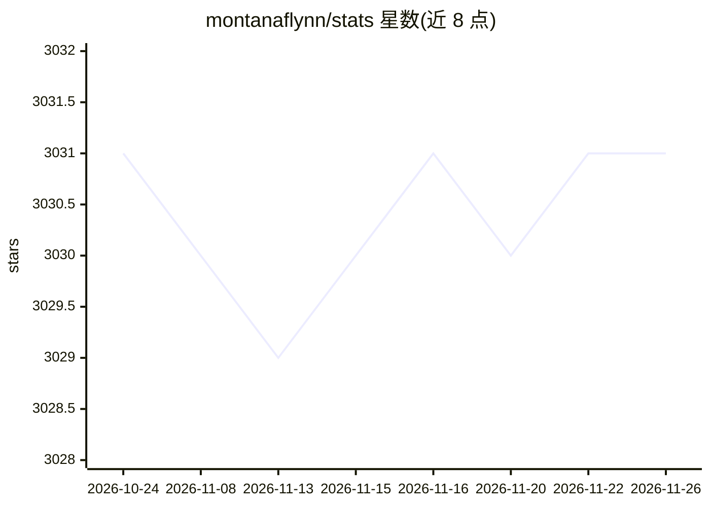

# montanaflynn/stats

⭐ 3,031 · Go · MIT · 推送 2026-10-25 · [GitHub](https://github.com/montanaflynn/stats) · [官网](https://pkg.go.dev/github.com/montanaflynn/stats) · 个人维护

**给 Go 开发者的零依赖统计函数库**

纯 Go 编写的统计库，无第三方依赖，提供中位数、百分位数、相关性等统计函数（导出 API 列表见 README），包含错误类型定义（空输入、NaN 处理）。通过 go get 安装，API 文档发布在 pkg.go.dev，也支持 go doc 离线查看。项目采用 Conventional Commits 规范，用 GoReleaser 自动化发布流程，MIT 许可。主题标签含 machine-learning，可配合数据分析流程使用。

## 筛选速览

| 维度 | 判定 | 备注 |
|---|---|---|
| AI 角色 | `ai-native` | 本体是模型或模型工具 |
| 许可风险 | `permissive` | MIT |
| 部署形态 | `None` |  |
| 模型依赖 | — | README 未给出锁定关系 |
| 硬件要求 | — | 无带数字的原话,不猜 |
| 安装摩擦 | `low` | 无编译、无系统依赖或容器化 |
| 成熟度 | — | 结构信号不足 |

## 能力要点

- 零第三方依赖的纯 Go 统计函数库
- API 文档发布在 pkg.go.dev 并支持 go doc 离线查看
- GoReleaser + GitHub Actions 自动化发布
- MIT 许可

## 适用场景

- Go 项目中计算中位数、百分位数等统计量
- 数据分析流程中做相关性计算
- 需要零依赖统计能力的服务端代码

## 场景标签

 · 领域:软件开发/统计计算

## 证据(README 行号)

> L5: A well tested and comprehensive Golang statistics library / package / module with no dependencies.
> L12: go get github.com/montanaflynn/stats

## 星数曲线

2026-10-24 3,031 → 2026-11-26 3,031（+0）

---
*卡片 v1 · prompt 1.4 · 生成 2026-11-23 · 置信度 high · 依据 README sha `2ff24e3fdbff` · [字段定义](../../DATASET.md)*
