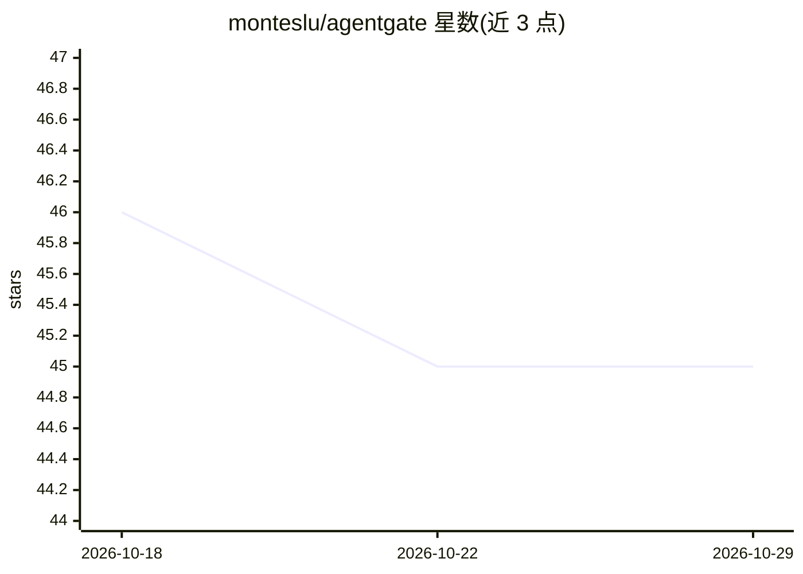

# monteslu/agentgate

⭐ 45 · JavaScript · 推送 2026-05-08 · [GitHub](https://github.com/monteslu/agentgate) · 个人维护

**自托管 API 网关：让 AI agent 经人工审批访问个人数据服务**

开源、可自托管的 API 网关，用于 AI agent 访问外部服务（GitHub、Google Calendar、Reddit 等 11 种）。核心机制：读操作立即执行，写操作进入队列等待人工在 UI 中批准或拒绝；agent 通过 API key 访问且不接触真实凭据。另提供 MCP server（配合 Claude Code 等 MCP 客户端）、agent 间消息、持久记忆（Mementos）、访问控制与 webhook。通过 npx 一行启动，支持 systemd/Docker/PM2 部署；文档要求与 agent 分机运行以避免数据库被直接读取。

## 筛选速览

| 维度 | 判定 | 备注 |
|---|---|---|
| AI 角色 | `ai-ecosystem` | LLM/agent 周边工具 |
| 许可风险 | `none` | — |
| 部署形态 | `library` | 以包/库形式分发 |
| 模型依赖 | — | README 未给出锁定关系 |
| 硬件要求 | — | 无带数字的原话,不猜 |
| 安装摩擦 | `low` | 无编译、无系统依赖或容器化 |
| 成熟度 | — | 结构信号不足 |

## 能力要点

- 读立即执行、写操作入队等待人工批准的 human-in-the-loop 机制
- 支持 GitHub、Google Calendar、Reddit 等 11 种外部服务
- 提供 MCP server，agent 不接触真实凭据
- agent 间消息、持久记忆存储与允许/拒绝列表访问控制

## 适用场景

- 让 AI agent 安全地代我操作社交账号和日程等服务，写操作由我审批
- 为多个 agent 集中管理对外部服务的访问权限与凭据
- 通过 MCP 接入 Claude Code 等客户端并保留人工审批环节

## 场景标签

 · 领域:AI agent 基础设施/安全

## 证据(README 行号)

> L3:  Open-source, self-hosted API gateway for AI agents to access external services with human-in-the-loop write approva
> L13: **Reads** execute immediately. **Writes** queue for human approval.

## 星数曲线

2026-10-18 46 → 2026-10-29 45（-1）

---
*卡片 v1 · prompt 1.4 · 生成 2026-10-25 · 置信度 mid · 依据 README sha `1475557af49d` · [字段定义](../../DATASET.md)*
