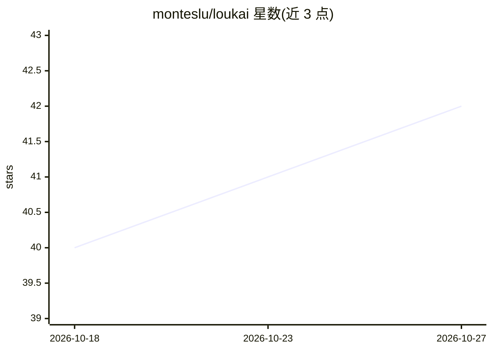

# monteslu/loukai

⭐ 42 · JavaScript · NOASSERTION · 推送 2026-09-30 · [GitHub](https://github.com/monteslu/loukai) · 个人维护

**本地运行的开源卡拉OK软件：播放并制作分轨卡拉OK文件**

基于 Electron/React 的跨平台桌面卡拉OK应用（Linux/Windows/macOS），播放与制作基于 NI Stems（MPEG-4 多轨音频）的卡拉OK文件，兼容 Traktor、Mixxx 等 DJ 软件。内置 Creator 功能用 Demucs 做音轨分离、Whisper 转写歌词、CREPE 检测调性，此功能需 WebGPU 真实 GPU、无 CPU 回退。另含实时音高修正、Web 远控与手机点歌、手柄操控、可视化与 CDG 旧格式支持。AGPL v3 许可，可通过 npx 或源码构建安装。

## 筛选速览

| 维度 | 判定 | 备注 |
|---|---|---|
| AI 角色 | `ai-enhanced` | 去掉 AI 部分产品仍成立 |
| 许可风险 | `none` | NOASSERTION |
| 部署形态 | `library` | 以包/库形式分发 |
| 模型依赖 | — | README 未给出锁定关系 |
| 硬件要求 | — | 无带数字的原话,不猜 |
| 安装摩擦 | `low` | 无编译、无系统依赖或容器化 |
| 成熟度 | — | 结构信号不足 |

## 能力要点

- Demucs 音轨分离 + Whisper 歌词转写 + CREPE 调性检测，打包为 .stem.mp4
- 基于 NI Stems 开放格式，兼容 Traktor/Mixxx 等 DJ 软件
- Web 远程管理与手机扫码点歌（Socket.IO/WebRTC）
- 跨平台桌面应用（Linux/Windows/macOS，x64 与 ARM64）

## 适用场景

- 在家用电脑上办卡拉OK 并用手机点歌
- 把自己的音乐做成带逐字歌词的分轨卡拉OK文件
- KJ 场景下管理队列、双输出（PA+返听）与请求审批

## 场景标签

 · 领域:音频/娱乐软件

## 证据(README 行号)

> L24: - **Create Your Own**: Built-in Creator processes your audio files into stem-separated karaoke with AI-transcribed 
> L261:  - Separate audio into stems using Demucs (AI stem separation)
> L262:  - Transcribe lyrics using Whisper (AI speech recognition)

## 星数曲线

2026-10-18 40 → 2026-10-27 42（+2）

---
*卡片 v1 · prompt 1.4 · 生成 2026-10-25 · 置信度 high · 依据 README sha `fdbd10838110` · [字段定义](../../DATASET.md)*
