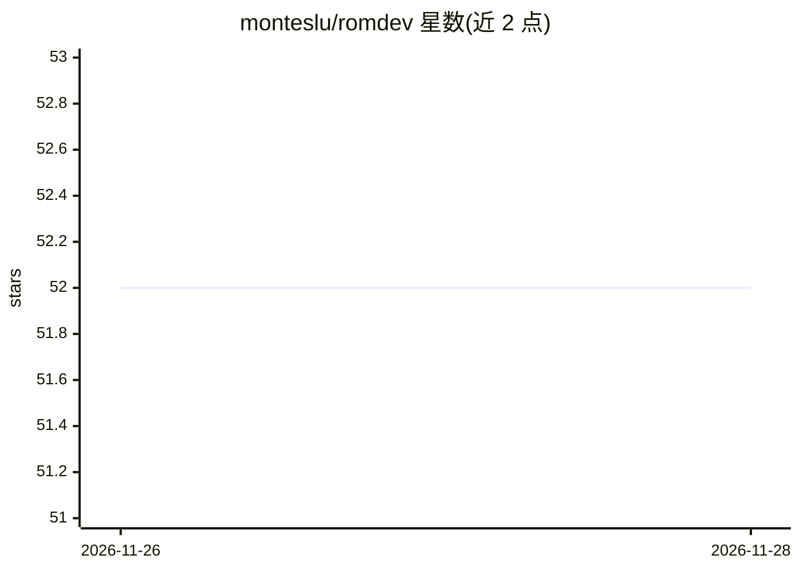

# monteslu/romdev

⭐ 52 · JavaScript · NOASSERTION · 推送 2026-11-17 · [GitHub](https://github.com/monteslu/romdev) · 个人维护

**面向编码 agent 的复古游戏机 ROM 开发与调试 MCP 工具服务器**

romdev 是一个通过 MCP 或 HTTP 暴露 38 个工具的服务器，供编码 agent（或人工/脚本）构建、运行、调试、逆向工程与静态重编译复古主机游戏，覆盖 Atari 2600 到 Dreamcast 等 19 个平台及 PICO-8、wasmcart、jsgame 运行时。所有编译器、libretro 模拟器核心与分析引擎（Rizin/Ghidra）以 WebAssembly 形式经 npm 分发，安装后无其他依赖；输出标准 ROM 文件，可在其他模拟器、烧录卡与真机上运行。

## 筛选速览

| 维度 | 判定 | 备注 |
|---|---|---|
| AI 角色 | `ai-enhanced` | 去掉 AI 部分产品仍成立 |
| 许可风险 | `none` | NOASSERTION |
| 部署形态 | `library` | 以包/库形式分发 |
| 模型依赖 | — | README 未给出锁定关系 |
| 硬件要求 | — | 无带数字的原话,不猜 |
| 安装摩擦 | `medium` | 含编译或系统依赖之一 |
| 成熟度 | — | 结构信号不足 |

## 能力要点

- 38 个 MCP/HTTP 工具：构建、资产转换、模拟器内存/断点检查、反编译、静态重编译
- 19 个平台的工具链（cc65、SDCC、RGBDS、SGDK 等）全部以 WebAssembly 经 npm 分发
- 逐帧验证重编译结果（像素、内存、音频比对）与差异定位工具
- playtest 打开 SDL 窗口供人工试玩，agent 同时继续工作

## 适用场景

- 让编码 agent 从示例 fork 出项目并一键构建、运行、截图
- 对现有 ROM 做逆向：内存搜索、断点、可重建反汇编与作弊码数据库
- 将 NES/SNES/GBA/Genesis 等 ROM 静态重编译为 wasmcart
- 开发需在真机运行的家庭brew 复古主机游戏

## 场景标签

`编码 Agent` · 领域:编码与开发

## 证据(README 行号)

> L3: romdev is a tool server that lets a coding agent (or you) build, run, debug, reverse-engineer and recompile retro co
> L13: romdev exposes 38 tools over MCP and plain HTTP. Each tool is a verb with an operation axis, such as `memory({op:'s
> L33: The tools work just as well called by hand or from scripts.

## 星数曲线

2026-11-26 52 → 2026-11-28 52（+0）

---
*卡片 v1 · prompt 1.4 · 生成 2026-11-26 · 置信度 high · 依据 README sha `8ccc758645bf` · [字段定义](../../DATASET.md)*
