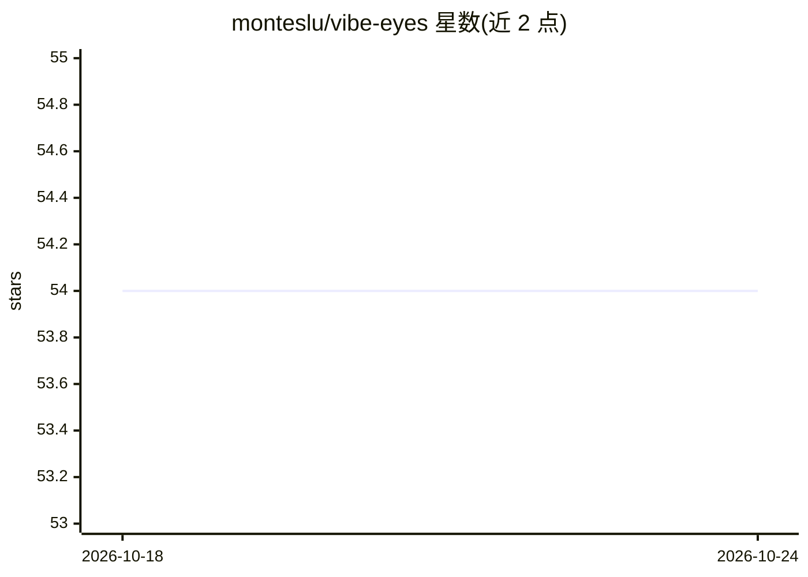

# monteslu/vibe-eyes

⭐ 54 · JavaScript · MIT · 推送 2026-02-04 · [GitHub](https://github.com/monteslu/vibe-eyes) · 个人维护

**让 LLM 通过 MCP「看见」浏览器 Canvas 内容与调试信息的 MCP 服务器**

由浏览器客户端与 Node.js 服务器组成的 MCP 服务器：客户端捕获页面 Canvas 快照、控制台日志、错误与未处理异常，经 Socket.IO WebSocket 发送到服务器；服务器将位图栅格图像矢量化为紧凑的 SVG 近似表示，连同调试信息通过 Model Context Protocol 暴露给 LLM（getGameDebug 工具），并附时间与关联信息。项目自称实验性，定位为增强开发者与 LLM 的「vibe coding」调试会话。支持 Smithery、npm 与源码安装，含独立矢量化 CLI。

## 筛选速览

| 维度 | 判定 | 备注 |
|---|---|---|
| AI 角色 | `ai-ecosystem` | LLM/agent 周边工具 |
| 许可风险 | `permissive` | MIT |
| 部署形态 | `library` | 以包/库形式分发 |
| 模型依赖 | — | README 未给出锁定关系 |
| 硬件要求 | — | 无带数字的原话,不猜 |
| 安装摩擦 | `low` | 无编译、无系统依赖或容器化 |
| 成熟度 | `idea` | |

## 能力要点

- Canvas 内容矢量化为紧凑 SVG 供 LLM 读取
- 实时收集控制台日志、错误与带堆栈的未处理异常
- 通过 MCP 暴露 getGameDebug 工具，输出含 SVG 近似、日志与时间关联信息
- 附独立矢量化 CLI 与 HTTP /latest 端点

## 适用场景

- 在用 LLM 辅助开发浏览器游戏/应用时让模型看到实际画面与报错
- 将视觉状态与控制台日志关联，定位代码问题
- 在 MCP 客户端（如 Claude Code）中集成浏览器调试上下文

## 场景标签

 · 领域:LLM 工具链/MCP

## 证据(README 行号)

> L7: An MCP server that enables LLMs to "see" what's happening in browser-based games and applications through vectorized
> L43: 5. LLMs connect via the Model Context Protocol to access the latest data
> L53: - Exposes the data via Model Context Protocol (MCP)

## 星数曲线

2026-10-18 54 → 2026-10-24 54（+0）

---
*卡片 v1 · prompt 1.4 · 生成 2026-10-24 · 置信度 high · 依据 README sha `a6e1c8cbc9a2` · [字段定义](../../DATASET.md)*
