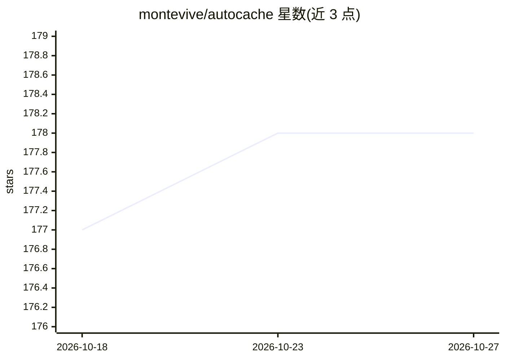

# montevive/autocache

⭐ 178 · Go · MIT · 推送 2026-02-02 · [GitHub](https://github.com/montevive/autocache) · [官网](https://montevive.ai) · 个人维护

**给 Anthropic API 用户的透明缓存代理：自动注入 prompt 缓存**

用 Go 编写的自托管代理服务器，部署在应用与 Anthropic API 之间：分析进入的 /v1/messages 请求，按 token 计数与所选策略（conservative/moderate/aggressive，最多 4 个断点）在系统提示、工具定义和内容块处自动注入 cache-control 字段，无需改动客户端代码。面向使用 n8n、Flowise、Make.com、LangChain 等不支持 Anthropic prompt caching 的平台的开发者。响应头返回 ROI 指标（缓存比例、节省百分比、回本请求数），提供 /health、/metrics、/savings 端点；图像内容不可缓存，各模型有最小 token 门槛（如 1024/2048）。通过 GHCR Docker 镜像或 Go 源码编译部署。

## 筛选速览

| 维度 | 判定 | 备注 |
|---|---|---|
| AI 角色 | `ai-ecosystem` | LLM/agent 周边工具 |
| 许可风险 | `permissive` | MIT |
| 部署形态 | `self-host` | docker 或自建部署 |
| 模型依赖 | locked-api |  |
| 硬件要求 | — | 无带数字的原话,不猜 |
| 安装摩擦 | `low` | 无编译、无系统依赖或容器化 |
| 成熟度 | — | 结构信号不足 |

## 能力要点

- 透明代理自动注入 cache-control 字段，客户端仅改 API 地址
- 三种缓存策略与可配置断点数（1-4）、token 阈值倍数
- 响应头实时返回 ROI 指标（缓存比例、节省、回本分析）
- 支持流式与非流式请求，提供 Docker 与 docker-compose 部署

## 适用场景

- 让 n8n/Flowise/Make.com 工作流无改动地获得 Anthropic prompt caching
- 监控代理的成本节省与缓存命中率
- 多租户场景下通过请求头按用户传递 API key

## 场景标签

 · 领域:LLM 基础设施/API 网关

## 证据(README 行号)

> L11: Autocache is a smart proxy server that automatically injects cache-control fields into Anthropic Claude API request
> L39: **Autocache** works as a transparent proxy that automatically analyzes your requests and injects cache-control head
> L277: Drop-in replacement for Anthropic's `/v1/messages` endpoint with automatic cache injection.

## 星数曲线

2026-10-18 177 → 2026-10-27 178（+1）

---
*卡片 v1 · prompt 1.4 · 生成 2026-10-22 · 置信度 high · 依据 README sha `7fe47aa6f85f` · [字段定义](../../DATASET.md)*
