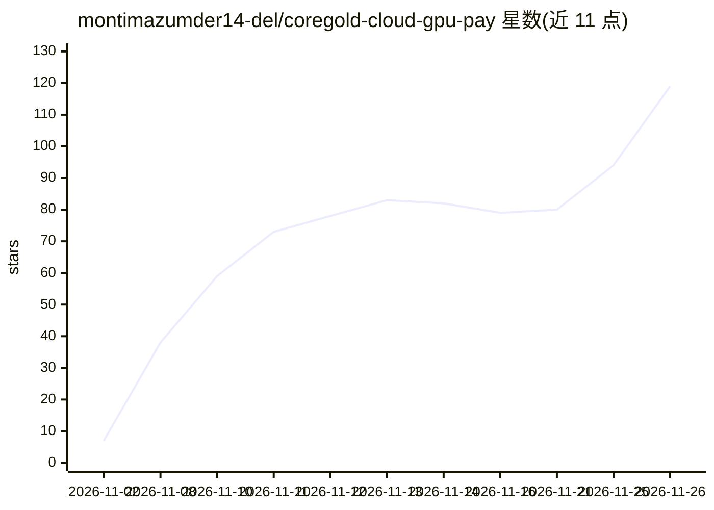

# montimazumder14-del/coregold-cloud-gpu-pay

⭐ 119 · 推送 2026-11-02 · [GitHub](https://github.com/montimazumder14-del/coregold-cloud-gpu-pay) · [官网](https://app.coregold.io/signup?invite_code=ADvlj9b) · 个人维护 · 中文 README

**面向海外云 GPU 租用付费的虚拟卡（VCC）推广页**

这不是软件项目，而是 CoreGold 虚拟信用卡服务的营销说明：声称生成欧美 Tier-1 商业 BIN 的 Visa/Mastercard 虚拟卡，用 USDT 充值、按项目设单卡限额、附配英文账单地址，用于 Lambda Labs、RunPod、Vast.ai、JarvisLabs 等云 GPU 平台的绑卡与扣费，并宣称可规避充值风控拒付与忘记关机的超额扣费；用完一键销卡、余额退回母账户。仓库无代码、无安装步骤，仅引导注册第三方发卡后台。

## 筛选速览

| 维度 | 判定 | 备注 |
|---|---|---|
| AI 角色 | `ai-enhanced` | 去掉 AI 部分产品仍成立 |
| 许可风险 | `none` | — |
| 部署形态 | `None` |  |
| 模型依赖 | — | README 未给出锁定关系 |
| 硬件要求 | — | 无带数字的原话,不猜 |
| 安装摩擦 | `low` | 无编译、无系统依赖或容器化 |
| 成熟度 | — | 结构信号不足 |

## 能力要点

- 生成独立海外 Visa/Mastercard 商业虚拟卡，USDT 充值
- 单卡限额与账单地址（AVS）配置，面向云 GPU 平台扣费场景
- 列出的适配平台：Lambda Labs、RunPod、Vast.ai、JarvisLabs

## 适用场景

- 为海外云 GPU 平台租用提供可限额的付费卡片
- 多实验/多团队场景下按项目隔离支付额度
- 项目结束后注销卡片、回收余额

## 场景标签

 · 领域:支付/云算力租用

## 证据(README 行号)

> L5: > **一句话大实话**：2026 年本地显存不够跑大参数模型，所有人都在租海外云 GPU（Lambda Labs、RunPod、Vast.ai、JarvisLabs）。最崩溃的不是抢不到 H100/H200 实例，而是充值结算时国
> L7: > 用 **CoreGold** 生成独立的海外 Visa / Mastercard 商业虚拟卡，纯净 Tier-1 商业 BIN，USDT 随充随走，单机单卡额度焊死，算力用完一键注销，把欠费和被拒风险全部物理隔离。

## 星数曲线

2026-11-02 7 → 2026-11-26 119（+112）

---
*卡片 v1 · prompt 1.4 · 生成 2026-11-18 · 置信度 mid · 依据 README sha `c4b5aa64f075` · [字段定义](../../DATASET.md)*
