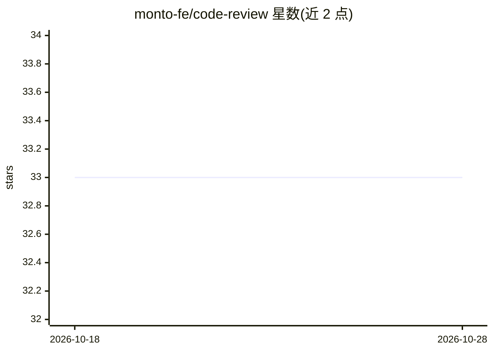

# monto-fe/code-review

⭐ 33 · Go · 推送 2026-02-11 · [GitHub](https://github.com/monto-fe/code-review) · [官网](https://code-review-home.vercel.app/) · 组织维护 · 中文 README

**给开发团队：基于大模型的 GitLab 代码审查服务**

面向 GitLab 的自动化代码审查服务：通过 Webhook 监听 Merge Request 与 Push 事件，调用大模型（集成 DeepSeek、UCloud、Qwen 等，支持切换私有/公有大模型）生成审查结果，并以行级评论形式回写到 GitLab，可推送至企业微信机器人。提供控制台管理模型 Key、GitLab Token 与自定义提示词，支持 RAG 检索代码仓库。通过 Docker Compose 一键启动服务与 MySQL/MariaDB 数据库，已测试 GitLab 12.9.2 与 16.11.5 版本。

## 筛选速览

| 维度 | 判定 | 备注 |
|---|---|---|
| AI 角色 | `ai-enhanced` | 去掉 AI 部分产品仍成立 |
| 许可风险 | `none` | — |
| 部署形态 | `self-host` | docker 或自建部署 |
| 模型依赖 | locked-api |  |
| 硬件要求 | — | 无带数字的原话,不猜 |
| 安装摩擦 | `low` | 无编译、无系统依赖或容器化 |
| 成熟度 | — | 结构信号不足 |

## 能力要点

- Webhook 触发 MR/Push 事件的 AI 代码审查
- 集成 DeepSeek、UCloud、Qwen 模型，支持私有/公有模型切换
- 支持 RAG 检索代码仓库与行级评论
- Docker Compose 一键启动，内置 MySQL/MariaDB 方案

## 适用场景

- 团队在 GitLab 提交 MR 时自动获得 AI 代码审查
- 通过自定义提示词定制检测规则
- 审查结果推送企业微信机器人

## 场景标签

`代码审查` · 领域:编码与开发

## 证据(README 行号)

> L3:  基于 AI 的自动化代码审查系统
> L4:  支持 GitLab Merge Request 审查，可通过 Docker Compose 一键启动服务与数据库
> L91: 提交 Merge Request 时将自动触发 AI 审查。

## 星数曲线

2026-10-18 33 → 2026-10-28 33（+0）

---
*卡片 v1 · prompt 1.4 · 生成 2026-10-25 · 置信度 high · 依据 README sha `de1f57b9475b` · [字段定义](../../DATASET.md)*
