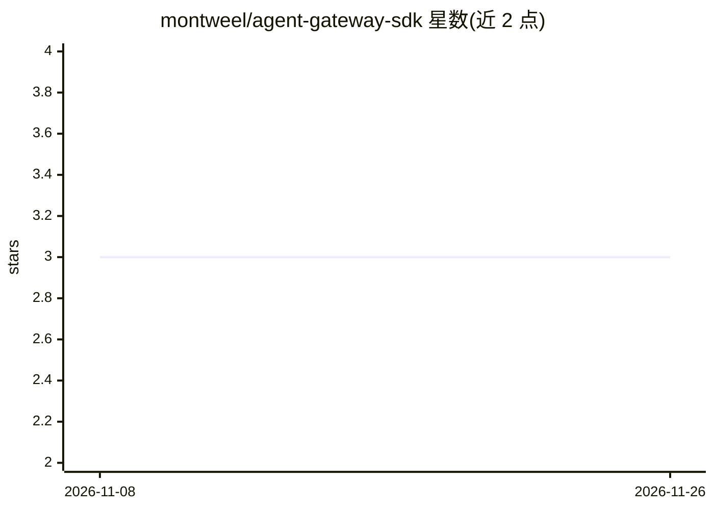

# montweel/agent-gateway-sdk

⭐ 3 · TypeScript · 推送 2026-11-16 · [GitHub](https://github.com/montweel/agent-gateway-sdk) · [官网](https://montweel.com) · 个人维护

**为 AI agent 流量提供防火墙、限流与人工审批的本地网关及 SDK**

以本地优先、fail-closed 方式拦截 AI agent 的 REST 调用与 MCP 工具调用，提供三种使用形态：Express 中间件、无代码反向代理、MCP 代理（stdio/Streamable HTTP/SSE）。核心机制包括按路由的默认拒绝规则、payload 策略、每路由限流、消费预算与重复操作防护、人工审批队列（电话/Slack/Telegram 审批）、哈希链防篡改审计日志与 PII 脱敏。数据存于内嵌 SQLite，无需 Redis/Postgres/云账号。采用 open-core 模式，Community 免费版之外有 Pro（$30/月）与 Agency 付费层。

## 筛选速览

| 维度 | 判定 | 备注 |
|---|---|---|
| AI 角色 | `ai-ecosystem` | LLM/agent 周边工具 |
| 许可风险 | `none` | — |
| 部署形态 | `self-host` | docker 或自建部署 |
| 模型依赖 | — | README 未给出锁定关系 |
| 硬件要求 | — | 无带数字的原话,不猜 |
| 安装摩擦 | `low` | 无编译、无系统依赖或容器化 |
| 成熟度 | — | 结构信号不足 |

## 能力要点

- 默认拒绝的按路由/按 payload 规则，全部检查通过且审计行落库后才转发（fail-closed）
- MCP 工具调用防火墙：未列出的工具默认拦截，支持三种传输方式
- 人工审批队列：payload 检查器、Edit & Approve、Telegram/Slack 按钮、24 小时过期
- 哈希链防篡改审计日志，含请求与响应脱敏载荷及审批人归因

## 适用场景

- 给调用自家电商/支付 API 的 agent 加退款审批与消费预算
- 把 MCP 客户端的工具调用套上默认拒绝策略与审计
- 为 agent 造成的问题操作留存可用于审计的防篡改证据

## 场景标签

`网络安全` · 领域:学习与行业

## 证据(README 行号)

> L14: Mont is a local-first, fail-closed API gateway and human-in-the-loop firewall for AI agent traffic: REST calls and 
> L18: - as an **MCP proxy** between Claude, Cursor or your agent framework and its tools
> L161: ### 3. MCP tool-call firewall

## 星数曲线

2026-11-08 3 → 2026-11-26 3（+0）

---
*卡片 v1 · prompt 1.4 · 生成 2026-11-21 · 置信度 high · 依据 README sha `b982198b9ba4` · [字段定义](../../DATASET.md)*
