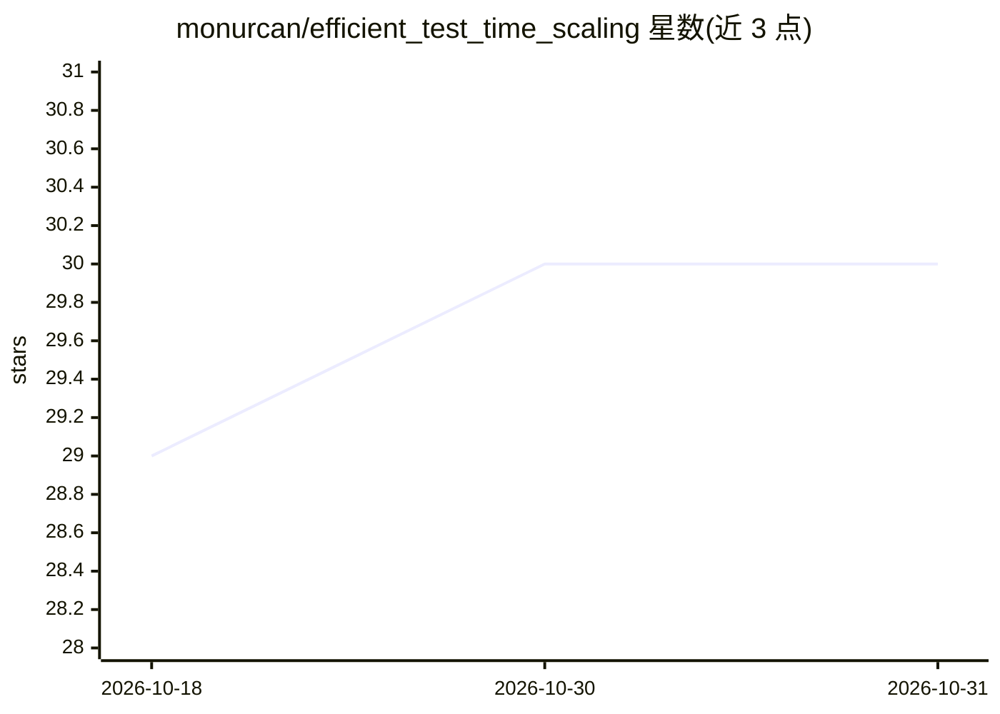

# monurcan/efficient_test_time_scaling

⭐ 30 · Python · 推送 2025-11-17 · [GitHub](https://github.com/monurcan/efficient_test_time_scaling) · [官网](https://monurcan.github.io/efficient_test_time_scaling) · 组织维护

**小型 VLM 的测试时扩展官方实现：增强聚合与测试时适应提升推理性能**

ICLR'26 论文 Efficient Test-Time Scaling for Small Vision-Language Models 的官方实现，作者来自丹麦技术大学、Pioneer Center for AI 与哥本哈根大学。提供两条流水线：TTAug 对输入图像与提示做多增强并逐 token 聚合输出、无参数更新；TTAdapt 用 TTAug 的伪标签在推理时微调模型参数。方法在九个基准上验证，代码基于 VLMEvalKit 构建，通过 git clone + pip 安装，用 bash 脚本运行基准实验，测试环境为 Python 3.10.12 与 CUDA 12.5。

## 筛选速览

| 维度 | 判定 | 备注 |
|---|---|---|
| AI 角色 | `ai-native` | 本体是模型或模型工具 |
| 许可风险 | `none` | — |
| 部署形态 | `library` | 以包/库形式分发 |
| 模型依赖 | — | README 未给出锁定关系 |
| 硬件要求 | — | 无带数字的原话,不猜 |
| 安装摩擦 | `medium` | 含编译或系统依赖之一 |
| 成熟度 | — | 结构信号不足 |

## 能力要点

- TTAug：多增强输入、token 级聚合、无参数更新
- TTAdapt：基于一致性伪标签的推理时参数适应
- 九个基准上验证，跨不同规模与不同 VLM 可用
- 构建于 VLMEvalKit 之上，带配置系统与结果可视化脚本

## 适用场景

- 在小模型上通过测试时扩展提升 VLM 推理性能
- 复现论文中九个基准上的实验结果
- 在资源受限环境中做测试时适应研究

## 场景标签

`多模态` · 领域:感知与多模态

## 证据(README 行号)

> L9: Our framework consists of two main pipelines: (1) Test-Time Augmentation: Given an input image and text prompt, we a
> L12: Small Vision-Language Models (VLMs) provide a computationally efficient alternative to larger models, at the cost o
> L44: This project builds upon VLMEvalKit.

## 星数曲线

2026-10-18 29 → 2026-10-31 30（+1）

---
*卡片 v1 · prompt 1.4 · 生成 2026-10-26 · 置信度 mid · 依据 README sha `2678efe481b5` · [字段定义](../../DATASET.md)*
