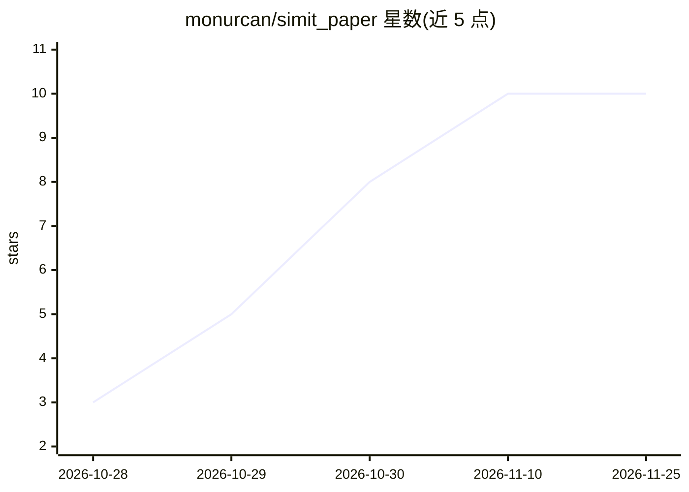

# monurcan/simit_paper

⭐ 10 · Python · Apache-2.0 · 推送 2026-11-23 · [GitHub](https://github.com/monurcan/simit_paper) · [官网](https://monurcan.github.io/simit) · 组织维护

**SIMIT 测试时自改进 VLM 框架的论文官方实现**

研究代码库，复现论文全部实验：给定无标注测试查询，模型按置信度分配合成预算，生成（问题、答案、图像）三元组——答案先行、图像由原生图像生成或渲染技能库实现，再经多阶段验证与难度过滤，通过上下文学习（SIMIT-ICL）或微调（SIMIT-FT）自改进。另提供轻量 pip 库 simit 供项目中使用。运行依赖两个 uv 管理的 Python 环境与无头 Chromium、Mermaid CLI。

## 筛选速览

| 维度 | 判定 | 备注 |
|---|---|---|
| AI 角色 | `ai-native` | 本体是模型或模型工具 |
| 许可风险 | `permissive` | Apache-2.0 |
| 部署形态 | `library` | 以包/库形式分发 |
| 模型依赖 | — | README 未给出锁定关系 |
| 硬件要求 | — | 无带数字的原话,不猜 |
| 安装摩擦 | `medium` | 含编译或系统依赖之一 |
| 成熟度 | `idea` | |

## 能力要点

- 自适应预算分配 + 三元组合成 + 多阶段验证与难度过滤
- 同一模型充当合成器、路由器、批评者与求解器
- 17 类结构化视觉的确定性渲染技能库
- REPRODUCE.md 列出每张表和图的复现命令

## 适用场景

- 复现 SIMIT 论文的实验结果
- 在视觉语言模型上做测试时自改进研究
- 用 pip 包 simit 在自己的项目中生成自合成示例

## 场景标签

`多模态` `微调` · 领域:感知与多模态

## 证据(README 行号)

> L22: > **This repository is the research codebase.** It contains everything needed to reproduce the
> L35: We introduce SIMIT, a test-time self-improvement framework in which a vision-language model creates its

## 星数曲线

2026-10-28 3 → 2026-11-25 10（+7）

---
*卡片 v1 · prompt 1.4 · 生成 2026-11-19 · 置信度 mid · 依据 README sha `8e2df3b29d27` · [字段定义](../../DATASET.md)*
