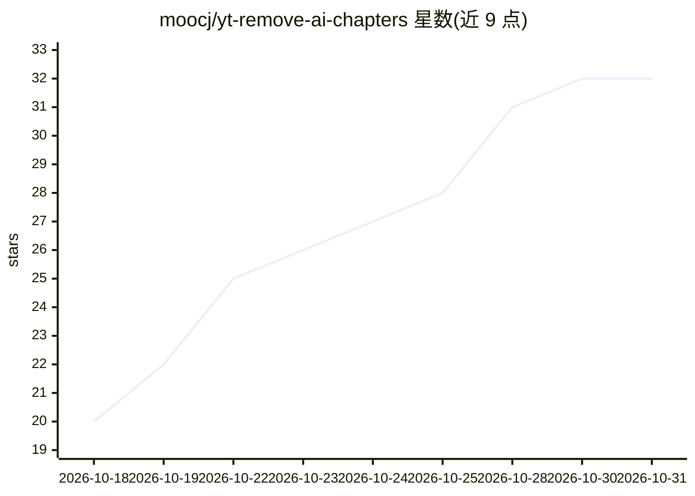

# moocj/yt-remove-ai-chapters

⭐ 32 · JavaScript · MIT · 推送 2026-10-15 · [GitHub](https://github.com/moocj/yt-remove-ai-chapters) · 个人维护

**移除 YouTube AI 自动生成章节的浏览器用户脚本**

一段浏览器用户脚本（userscript），用于移除 YouTube 为无章节视频自动添加的 AI 生成章节；由创作者手动添加的章节不受影响。安装方式包括从 Greasyfork 直接安装、Firefox 扩展形式安装，或经 Tampermonkey/Violentmonkey/Greasemonkey/Userscripts 等脚本管理器手动安装，安装后刷新 YouTube 生效。脚本本身不运行 AI 模型，仅对页面上的 AI 生成内容做移除处理。

## 筛选速览

| 维度 | 判定 | 备注 |
|---|---|---|
| AI 角色 | `ai-enhanced` | 去掉 AI 部分产品仍成立 |
| 许可风险 | `permissive` | MIT |
| 部署形态 | `None` |  |
| 模型依赖 | — | README 未给出锁定关系 |
| 硬件要求 | — | 无带数字的原话,不猜 |
| 安装摩擦 | `low` | 无编译、无系统依赖或容器化 |
| 成熟度 | — | 结构信号不足 |

## 能力要点

- 移除 YouTube AI 自动生成的视频章节
- 保留创作者手动添加的章节
- 支持 Greasyfork、Firefox 扩展及主流脚本管理器多种安装方式

## 适用场景

- 观看视频时去掉误导性或不准确的 AI 章节
- 恢复更顺畅的视频进度条拖动体验
- 仅保留创作者自己标注的章节

## 场景标签

 · 领域:浏览器用户脚本/视频平台工具

## 证据(README 行号)

> L3: Removes YouTube's AI-generated video chapters. Chapters added by the creator are not changed.
> L9: YouTube now add AI-generated chapters to videos that did not have any. These chapters are not only not very informat

## 星数曲线

2026-10-18 20 → 2026-10-31 32（+12）

---
*卡片 v1 · prompt 1.4 · 生成 2026-10-26 · 置信度 mid · 依据 README sha `22949fe98da4` · [字段定义](../../DATASET.md)*
