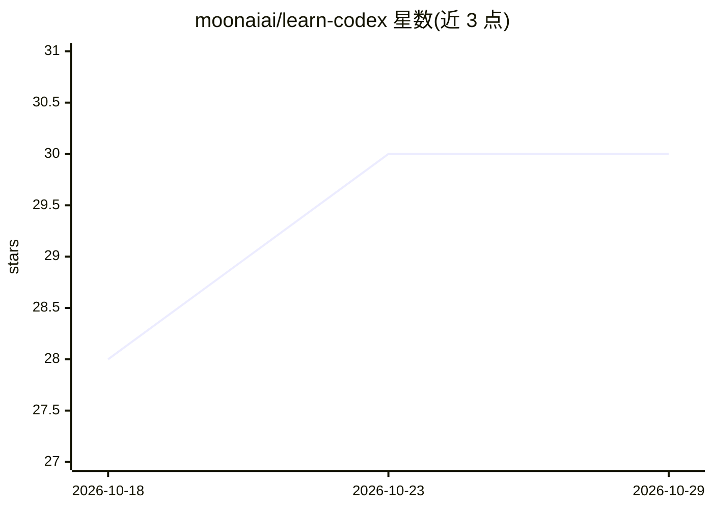

# moonaiai/learn-codex

⭐ 30 · TypeScript · MIT · 推送 2026-08-03 · [GitHub](https://github.com/moonaiai/learn-codex) · [官网](https://moonaiai.github.io/learn-codex/) · 组织维护 · 中文 README

**用 TypeScript 逐章重建 Codex 式编程 Agent harness 的双语教程**

面向开发者的 28 章课程仓库：Part I（s01–s20）从 30 行 Agent Loop 逐步叠加工具、审批、沙箱、上下文压缩、子代理、MCP 等机制，重建多代理平台；Part II（s21–s28）对照真实 codex CLI 讲解配置、插件、本地模型与安全模型。每章 code.ts 可独立运行，内置离线脚本化模型，无 API key 也可观察完整循环；文档站为静态 Next.js 站点，中英双语，需 Node.js ≥ 18。

## 筛选速览

| 维度 | 判定 | 备注 |
|---|---|---|
| AI 角色 | `ai-knowledge` | 知识聚合/清单类 |
| 许可风险 | `permissive` | MIT |
| 部署形态 | `library` | 以包/库形式分发 |
| 模型依赖 | local-ok | 支持本地模型 |
| 硬件要求 | — | 无带数字的原话,不猜 |
| 安装摩擦 | `low` | 无编译、无系统依赖或容器化 |
| 成熟度 | — | 结构信号不足 |

## 能力要点

- 28 章、每章一个机制，均可用 npx tsx 独立运行
- 内置离线演示模型，无 API key 即可跑通完整 Agent Loop
- Part II 命令与配置对照真实 codex CLI 验证
- 中英双语文档站，含架构图与交互式 Agent-Loop 模拟器

## 适用场景

- 系统学习 Codex 类 coding agent 的 harness 构建机制
- 按需查阅某一机制（如沙箱、上下文压缩、MCP 桥接）的自包含章节
- 配置与使用真实 Codex CLI、接入本地模型

## 场景标签

`教程课程` · 领域:学习与行业

## 证据(README 行号)

> L12: > A course on rebuilding a Codex-style coding-agent harness in **TypeScript**: **Part I (s01–s20)** progresses from
> L174: - **Runnable, not screenshots**: every `code.ts` runs standalone, with a built-in **offline scripted model** — you

## 星数曲线

2026-10-18 28 → 2026-10-29 30（+2）

---
*卡片 v1 · prompt 1.4 · 生成 2026-10-26 · 置信度 high · 依据 README sha `3b0f46171434` · [字段定义](../../DATASET.md)*
