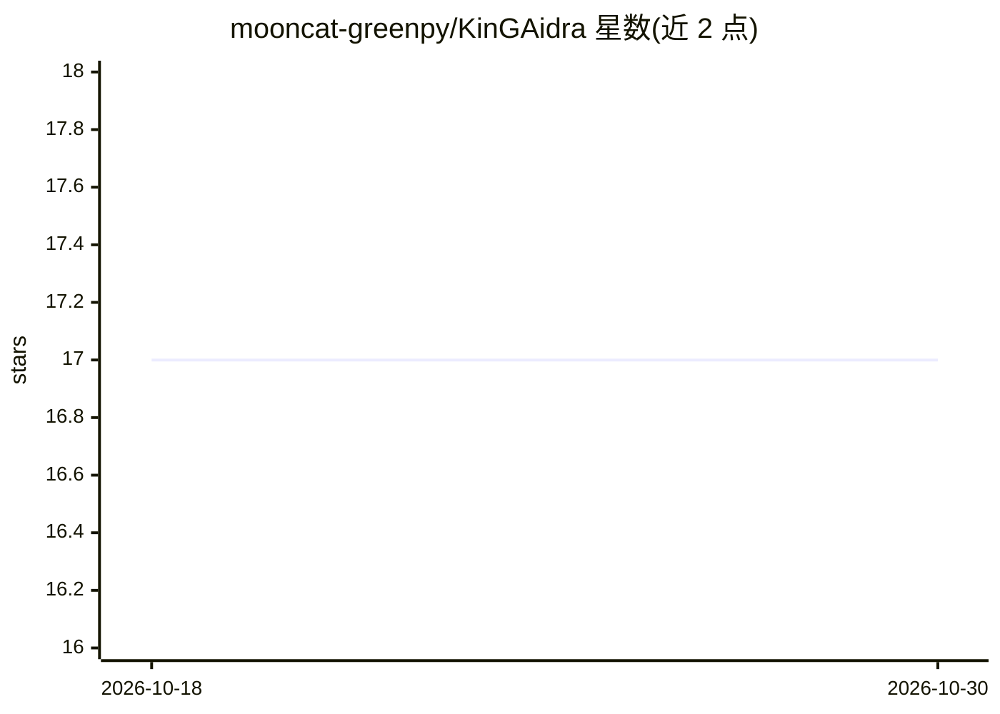

# mooncat-greenpy/KinGAidra

⭐ 17 · Java · 推送 2026-10-13 · [GitHub](https://github.com/mooncat-greenpy/KinGAidra) · 个人维护

**把 AI 辅助逆向工作流带进 Ghidra 的扩展插件**

面向逆向工程分析人员的 Ghidra 扩展：在 Ghidra 工作区内提供 Chat（自由提问）、DecomView（按函数生成 LLM C 视图）、Refactor（重命名/数据类型建议并应用）、KeyFunc（函数优先级排序）与自动注释生成等功能。会话与生成结果按程序存入程序数据库表，可随程序导出共享给队友。支持以 JSON 定义多步 SOP 工作流，在 UI 弹出菜单与 headless 批处理模式下以同名执行；Chat 内的 planner 可将自由文本请求即时转为工作流 JSON 并执行。通过 URL/MODEL/API_KEY 配置接入模型，含本地 LLM 使用文档。

## 筛选速览

| 维度 | 判定 | 备注 |
|---|---|---|
| AI 角色 | `ai-native` | 本体是模型或模型工具 |
| 许可风险 | `none` | — |
| 部署形态 | `None` |  |
| 模型依赖 | — | README 未给出锁定关系 |
| 硬件要求 | — | 无带数字的原话,不猜 |
| 安装摩擦 | `low` | 无编译、无系统依赖或容器化 |
| 成熟度 | — | 结构信号不足 |

## 能力要点

- 会话与结果按程序持久化存储，可随程序导出共享
- SOP-as-code：JSON 定义多步工作流，UI 与 headless 同名执行
- planner 将自由文本请求转为可执行工作流 JSON
- AI 输出渲染 Markdown 并含可点击地址跳转

## 适用场景

- 在 Ghidra 内让 LLM 解释反编译代码并生成注释
- 批量/CI 场景下用 headless 模式跑命名 AI 工作流
- 让 LLM 提出函数重命名与数据类型修改建议并应用
- 按团队 SOP 定制 JSON 工作流供分析员复用

## 场景标签

`网络安全` `AI 助手` `工作流自动化` · 领域:效率与自动化

## 证据(README 行号)

> L3: KinGAidra is a Ghidra extension that brings AI-assisted reverse engineering workflows directly into the Ghidra works
> L14: - **More than chat:** generate explanations, refactor suggestions, comments, key-function prioritization, and whole
> L62: - Generates LLM-based C view per function.

## 星数曲线

2026-10-18 17 → 2026-10-30 17（+0）

---
*卡片 v1 · prompt 1.4 · 生成 2026-10-29 · 置信度 high · 依据 README sha `e1a0cfb1c077` · [字段定义](../../DATASET.md)*
